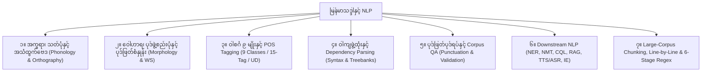

# မြန်မာသဒ္ဒါနှင့် NLP လုပ်ငန်းစဉ် (Myanmar Grammar & Downstream NLP Skill)

ပြည်ထောင်စုသမ္မတမြန်မာနိုင်ငံတော် ပညာရေးဝန်ကြီးဌာန၊ မြန်မာစာအဖွဲ့ဦးစီးဌာနမှ တည်းဖြတ်ထုတ်ဝေသော **မြန်မာသဒ္ဒါ (၂၀၁၃ ဒုတိယအကြိမ်)** ကျမ်း၊ **myPOS / Legal70k Corpus စံနှုန်းများ** နှင့် **Large-Scale Corpus Engineering / Downstream NLP နည်းပညာမူဘောင်များ** ကို စနစ်တကျ ပေါင်းစပ်ထားသော မြန်မာဘာသာစကား NLP skill ဖြစ်သည်။

## Authority — apply this before any annotation

Two standards live in this skill. They are not the same layer.

- **MLC 2013** (chapters 1–20) explains the grammar. Use it for teaching, morphology, and general Burmese.
- **Legal70k owner rules** (cheatsheet sections 6–10, plus the closed lists in the scripts) decide word breaks and the 15 tags for that corpus. When they conflict with a chapter, the owner rule wins **for Legal70k only**.
- Do not rewrite a chapter to match the corpus, and do not treat a corpus rule as universal Burmese.
- Whitespace is the only edit allowed on a corpus line. Never add, delete, or replace a Myanmar codepoint. Suspected typos are `RECORD_ONLY_NOT_APPLIED`.
- Output tags are the lowercase 15-tag set only. `DET`, `AUX`, `SCONJ`, `PROPN` are invalid in corpus files.
- If the context does not decide a tag, leave it in a review list. Do not guess.
- For a tag or a word break, run `scripts/decide.py` before opening a long guide. `closed` means use the tag. `review` means the JSON already lists the only legal readings. See [Decide first](references/decide-first.md).

## When to Use

- **Word Segmentation (ပုဒ်ဖြတ်ခြင်း / Tokenization)**: မြန်မာစာကြောင်းများကို မူရင်းသတ်ပုံမပျက်စေဘဲ (Orthographic Fidelity) ပုဒ်ဖြတ်ခြင်း၊ ပြိုကွဲနေသော ဝဏ္ဏများကို ပြန်ဆက်ခြင်း၊ Boundary-Shift အမှားများ စစ်ဆေးပြင်ဆင်ခြင်း။
- **Large-Corpus Chunking, Line-by-Line Streaming & Staged Regex Remediation**: ကြီးမားသော Corpus ဖိုင်များ (ဥပမာ 70,242+ သို့မဟုတ် 899,000+ လိုင်း) ကို 1-based global line number နှင့် SHA-256 manifest မပျက်စေဘဲ Chunk / Sub-Chunk ခွဲခြင်း၊ Line-by-Line ($O(1)$ memory) ဖတ်ရှုစစ်ဆေးပြင်ဆင်ခြင်းနှင့် အဆင့် (၆) ဆင့်ပါ Token-Bounded Regex Cascade (`Stage 1` မှ `Stage 6`) ဖြင့် အမှားကင်းစွာ ပြင်ဆင်ခြင်း။
- **POS Tagging & Framework Harmonization (သဒ္ဒါအညွှန်းတပ်ခြင်း)**: မြန်မာစာအဖွဲ့၏ ဝါစင်္ဂ ၉ မျိုး၊ Corpus အသုံးချ `myPOS` 15-tag စနစ် (`abb, adj, adv, conj, fw, int, n, num, part, ppm, pron, punc, sb, tn, v`) နှင့် Universal Dependencies (`UD v2`) တို့အကြား တိကျစွာ အညွှန်းတပ်ခြင်းနှင့် ချိတ်ဆက်ခြင်း။
- **Morphological & Compound Analysis (ပုဒ်နှင့် ပေါင်းစပ်ပုဒ် ခွဲခြမ်းစိတ်ဖြာခြင်း)**: ပုဒ် ၄ မျိုး (ပုဒ်ရိုး၊ ပေါင်းစပ်ပုဒ်၊ ပစ္စည်းရောပုဒ်၊ ဝိဘတ်သွယ်ပုဒ်)၊ `[တ/တစ် + X + တ/တစ် + Y]` လေးဝဏ္ဏပုဒ်များနှင့် Reconstructable Bracket Compound Layer (`[w1/p1 | w2/p2]/p`) တည်ဆောက်ခြင်း။
- **Downstream NLP Tasks**:
  - **Named Entity Recognition (NER / 15-Class BIO Standard)**: Standardized 15-Class NER (`GPE, LOC, ORG, PER, DATE, TIME, NUM, MONEY, TERM, EVENT, PRODUCT, FACILITY, NORP, DISEASE_PHENOMENON, MISC`) ဖြင့် BIO / IOB2 annotation ဆောင်ရွက်ခြင်း၊ နာမ်ဝိဘတ် (`ppm`) ကို Entity span အတွင်း မထည့်ဘဲ Clitic peeling ပြုလုပ်ခြင်းနှင့် ရာထူး/ဂုဏ်ပုဒ် (`ဗိုလ်ချုပ်, ဒေါက်တာ, သံအမတ်ကြီး`) များကို `O` အဖြစ် သီးခြားခွဲထုတ်ခြင်း။
  - **Dependency Parsing (`CoNLL-U` / `myUDTree`)**: SOV ဝါကျတည်ဆောက်ပုံ၊ နာမ်ဝိဘတ် (`case`)၊ အမှီဝါကျကဏ္ဍ ၃ မျိုး (`acl`, `advcl`, `ccomp`) နှင့် Treebank တည်ဆောက်မှု။
  - **Corpus Indexing, WPL `.vert` & CQL / Word Sketch**: Sketch Engine vertical ဖိုင်များ၊ CQL query များနှင့် GDEX ဝါကျရွေးချယ်မှု။
  - **Machine Translation (NMT), LLM/RAG Chunking, Speech (TTS/ASR/G2P) & Sentiment/Deontic IE**: BPE မတိုင်မီ ပုဒ်ဖြတ်ခြင်း၊ အသတ်/သရ မပျက်စေသော RAG chunking၊ စကားသံပြောင်းလဲမှု (Voicing Sandhi) နှင့် အငြင်းပြ/တာဝန်ပြ ဝါကျခွဲခြားမှု။

## 📌 အဓိက မဏ္ဍိုင်ကြီး ၇ ရပ်



## 📚 အခန်းများ မာတိကာ (Chapter Index)

### အပိုင်း ၁ - အက္ခရာနှင့် အသံထွက်ဗေဒ (Phonetics & Orthography)

- [Chapter 1: သဒ္ဒါ၊ အသံနှင့် အက္ခရာ](chapters/ch01-grammar-and-alphabet.md) - သဒ္ဒါသဘောတရား၊ အသံနှင့် အက္ခရာ ၄၄ လုံး ခွဲခြားမှု။
- [Chapter 2: သရ ၂ မျိုးနှင့် သံပြောင်းပြသင်္ကေတများ](chapters/ch02-vowels-and-tones.md) - အခြေခံသရ ၁၁ လုံး၊ သင်ရိုးသရ ၁၂ လုံး၊ မောက်ချ/ဝိုက်ချ စည်းမျဉ်း။
- [Chapter 3: ဗျည်းအက္ခရာ ၄ မျိုးနှင့် ဗျည်းတွဲစပ်ပုံ](chapters/ch03-consonants-and-clusters.md) - ဗျည်း ၃၃ လုံး၊ ယပင့်၊ ရရစ်၊ ဝဆွဲ၊ ဟထိုး တွဲစပ်ပုံ။
- [Chapter 4: အသတ်များ](chapters/ch04-asat-finals.md) - မြန်မာအသတ် ၈ မျိုး၊ ပါဠိသက်အသတ်နှင့် အသံထွက်နည်း။
- [Chapter 5: ဌာန်၊ ကရိုဏ်း၊ ပယတ်](chapters/ch05-phonetics-htan-karon-payat.md) - အသံဖြစ်ရာဌာန ၆ ပါး၊ ပြုလုပ်ရာကရိုဏ်း ၄ ပါး၊ ပယတ် ၂ ပါး။
- [Chapter 6: ပါဠိဆင့်ရေးနည်းနှင့် ဖတ်နည်း](chapters/ch06-pali-conjuncts.md) - ဝဂ်အလိုက် ၁-၂၊ ၃-၄၊ ၅-အားလုံး ဆင့်နည်းနှင့် ဖတ်နည်း။
- [Chapter 7: အသံနှင့် စကားသံဖွဲ့ထုံး](chapters/ch07-speech-sounds-phonology.md) - သံပြင်းမှ သံပျော့သို့ စကားသံပြောင်းလဲမှု (Voicing Alternation)။

### အပိုင်း ၂ - ပုဒ်နှင့် ဝေါဟာရဖွဲ့စည်းပုံ (Morphology)

- [Chapter 8: စကားလုံး၊ ပုဒ်နှင့် ပုဒ်စု](chapters/ch08-words-and-phrases.md) - အနက်ဆောင်/အနက်ထောက် စကားလုံးများမှ ပုဒ်နှင့် ပုဒ်စု တည်ဆောက်ပုံ။
- [Chapter 9: ပုဒ် ၄ မျိုး](chapters/ch09-four-word-types.md) - ပုဒ်ရိုး၊ ပေါင်းစပ်ပုဒ်၊ ပစ္စည်းရောပုဒ်၊ ဝိဘတ်သွယ်ပုဒ်။

### အပိုင်း ၃ - ဝါစင်္ဂ ၉ မျိုး (Word Classes / Parts of Speech)

- [Chapter 10: ဝါစင်္ဂ - နာမ်](chapters/ch10-word-classes-nouns.md) - နာမ် ၅ မျိုး (သမ္မာ၊ သာမည၊ စုပေါင်း၊ ဒြပ်ရှိ၊ ဒြပ်မဲ့)၊ လိင် ၄ မျိုးနှင့် ကိန်း ၂ မျိုး။
- [Chapter 11: ဝါစင်္ဂ - နာမ်စား](chapters/ch11-word-classes-pronouns.md) - ပုဂ္ဂလနာမ်စား ၃ မျိုး၊ အညွှန်း၊ အမေးနှင့် သင်္ချာနာမ်စားများ။
- [Chapter 12: ဝါစင်္ဂ - နာမဝိသေသန](chapters/ch12-word-classes-adjectives.md) - ပင်ကို၊ အညွှန်း၊ သင်္ချာနာမဝိသေသနနှင့် နှိုင်းယှဉ်အဆင့် ၃ ဆင့်။
- [Chapter 13: ဝါစင်္ဂ - ကြိယာနှင့် ကာလ](chapters/ch13-word-classes-verbs.md) - ကံလိုကြိယာ၊ ကံမလိုကြိယာနှင့် ကာလ ၃ ပါး (အတိတ်၊ ပစ္စုပ္ပန်၊ အနာဂတ်)။
- [Chapter 14: ဝါစင်္ဂ - ကြိယာဝိသေသန](chapters/ch14-word-classes-adverbs.md) - စွာ-ပစ္စည်း၊ နှစ်ကြိမ်ထပ်နှင့် ၄ လုံးစပ် ကာရန်လိုက် ကြိယာဝိသေသနများ။
- [Chapter 15: ဝါစင်္ဂ - ဝိဘတ်](chapters/ch15-word-classes-postpositions.md) - နာမ်ဝိဘတ် ၇ မျိုး (ကတ္တား၊ ကံ၊ ထွက်ခွာရာ၊ ရှေးရှုရာ၊ နေရာ၊ အသုံးခံ၊ ပိုင်ဆိုင်ရာ) နှင့် ကြိယာဝိဘတ်များ။
- [Chapter 16: ဝါစင်္ဂ - သမ္ဗန္ဓနှင့် ပစ္စည်း](chapters/ch16-word-classes-conjunctions-particles.md) - ဝါကျဆက်သမ္ဗန္ဓများ၊ နာမ်ပစ္စည်းနှင့် ကြိယာပစ္စည်းများ။
- [Chapter 17: ဝါစင်္ဂ - အာမေဍိတ်နှင့် ဝါစင်္ဂဆိုင်ရာ သိမှတ်ဖွယ်များ](chapters/ch17-word-classes-interjections.md) - စိတ်ခံစားမှုပြ အာမေဍိတ်များနှင့် ဝါစင်္ဂအချင်းချင်း ကူးပြောင်းမှု။

### အပိုင်း ၄ - ဝါကျဖွဲ့ထုံးနှင့် စကားအထားအသို (Syntax)

- [Chapter 18: ဝါကျဖွဲ့စည်းပုံ - ဝါကျရိုးနှင့် ဝါကျရော](chapters/ch18-sentence-structures.md) - ကတ္တား-ကံ-ကြိယာ (SOV) စနစ်၊ ဝါကျရိုးနှင့် ဝါကျရော။
- [Chapter 19: ဝါကျကဏ္ဍ၊ ခွဲခြမ်းစိတ်ဖြာခြင်းနှင့် စကားအထားအသို](chapters/ch19-sentence-analysis.md) - နာမ်၊ နာမဝိသေသန၊ ကြိယာဝိသေသန အမှီဝါကျကဏ္ဍ ၃ မျိုးနှင့် Parsing စနစ်။

### အပိုင်း ၅ - ပုဒ်ဖြတ်ပုဒ်ရပ် (Punctuation)

- [Chapter 20: ပုဒ်ဖြတ်ပုဒ်ရပ်သင်္ကေတများ](chapters/ch20-punctuation-marks.md) - ပုဒ်ကလေး (၊)၊ ပုဒ်မ (။)၊ မျဉ်းစောင်း၊ မျက်တောင်၊ ကွင်းစကွင်းပိတ် စနစ်တကျ သုံးစွဲပုံ။

## ⚡ အမြန်လမ်းညွှန် (Quick Lookup)

| လိုအပ်ချက် | သွားရောက်လေ့လာရမည့် အခန်း / ဖိုင် |
| --- | --- |
| ပုဒ်တစ်လုံးကို ဘာ tag ပေးရမလဲ၊ ခွဲရခက်သော ဝေါဟာရ | `scripts/decide.py` ပြီးမှ [Decide first](references/decide-first.md) |
| ဝါစင်္ဂ ၅ မျိုး ဘာသာဗေဒ သုတေသနနှင့် NLP မော်ဒယ်များ ဆန်းစစ်ချက် | [ဝါစင်္ဂ ၅ မျိုး NLP သုတေသန အစီရင်ခံစာ](references/myanmar-grammar-5-pos-linguistic-nlp-report.md) |
| အမြင်တူအက္ခရာ မှားရိုက်ထားခြင်း (`၀/ဝ`, `၇/ရ`, `၈/ဂ`, `၄/၎`, `စျ/ဈ`) | `scripts/confusable.py` ပြီးမှ [Lookalike keystrokes](references/confusables.md) |
| agent က ယခင်က မှားဆက်/မှားခွဲခဲ့သော ပုဒ်များ | [Agent hard cases](references/agent-hard-cases.md) |
| မောက်ချ (-ါ) သုံးရမည့် စည်းမျဉ်းကို သိလိုလျှင် | [Chapter 2](chapters/ch02-vowels-and-tones.md) |
| ဗျည်းတွဲ (ယပင့်၊ ရရစ်၊ ဝဆွဲ၊ ဟထိုး) စည်းမျဉ်းများ | [Chapter 3](chapters/ch03-consonants-and-clusters.md) |
| ပါဠိစာလုံးပေါင်းနှင့် ဗျည်းဆင့်ဖတ်နည်းများ | [Chapter 6](chapters/ch06-pali-conjuncts.md) |
| စကားသံပြောင်းလဲမှု (သံပြင်းမှ သံပျော့သို့ ကူးပုံ / TTS G2P) | [Chapter 7](chapters/ch07-speech-sounds-phonology.md) |
| နာမ်ဝိဘတ် ၇ မျိုးနှင့် အသုံးအနှုန်းများ | [Chapter 15](chapters/ch15-word-classes-postpositions.md) |
| ဝါကျရှည်များ ခွဲခြမ်းစိတ်ဖြာနည်း (Sentence Parsing) | [Chapter 19](chapters/ch19-sentence-analysis.md) |
| ပုဒ်ဖြတ်ပုဒ်ရပ် အမှားကင်းစွာ သုံးစွဲနည်း | [Chapter 20](chapters/ch20-punctuation-marks.md) |
| `[တ/တစ်]` လေးဝဏ္ဏ ဝေါဟာရဖြစ်ပုဒ်များနှင့် Owner NLP စံနှုန်းများ | [Cheatsheet Section 6](cheatsheet.md#corpus-rules) |
| ပုဒ်ဖြတ်စည်းမျဉ်း ဦးစားပေးအစဉ်၊ `-ရေး` စည်းမျဉ်းနှင့် Trap စာရင်း | [Segmentation & Lexicon Reference](references/segmentation-lexicon.md) |
| ဝါစင်္ဂ ၉ မျိုး <-> `myPOS` 15-Tag <-> `UD v2` Mapping နှင့် ခွဲခြားနည်း | [POS & UD Mapping Reference](references/pos-ud-mapping.md) |
| NER, Dependency Parsing, CQL, NMT, RAG/LLM, TTS/ASR လမ်းညွှန် | [Downstream NLP Guide](references/downstream-nlp-guide.md) |
| Corpus အကြီးစား Chunk ခွဲခြင်း၊ Line-by-Line စစ်ဆေးခြင်းနှင့် 6-Stage Regex | [Large-Corpus Chunking & Regex Guide](references/large-corpus-chunking-and-regex-pipeline.md) |
| မြန်မာဝဏ္ဏ (Syllable) နှင့် စကားလုံး (Word) အမြန် ပိုင်းခြားခြင်း CLI နှင့် Toolkit | [Syllable & Word Segmentation Toolkit](references/syllable-and-word-segmentation-toolkit.md) |
| သုဒ္ဓကြိယာနှင့် ကာရိုက်ကြိယာများ၊ Valency နှင့် MynNet FrameNet SRL | `scripts/verb_pair.py` ပြီးမှ [သုဒ္ဓ၊ ကာရိုက်](references/verb-function.md) |
| စကားပြောနှင့် စာအရေးအသား တွဲဖက်အသုံး | `scripts/register.py` ပြီးမှ [စကားပြောနှင့် စာအရေး](references/spoken-written.md) |
| နာမ်၊ နာမ်စား၊ နာမဝိသေသနနှင့် NLP နေရာ | `scripts/nominal.py` ပြီးမှ [နာမ်သုံးမျိုး](references/nominals.md) |
| ပစ္စည်းနှင့် ဝိဘတ် ခွဲခြားဆန်းစစ်မှု၊ Diagnostic Criteria နှင့် NLP Benchmarks | [Particles & Postpositions Guide](references/particles-and-postpositions-guide.md) |

## 🛠 ထောက်ပံ့ရေး ဖိုင်များနှင့် NLP ကိရိယာများ (Supporting References & Tools)

- **[Cheatsheet](cheatsheet.md)** - စည်းမျဉ်းများ၊ ဝိဘတ်ဇယား၊ အသံပြောင်းဇယား၊ Legal70k Owner စံနှုန်းများ (အပိုင်း ၆-၁၀)၊ Downstream NLP Matrix (အပိုင်း ၁၁-၁၂) နှင့် 6-Stage Regex & Chunking Matrix (အပိုင်း ၁၃)။
- **[Glossary](glossary.md)** - မြန်မာသဒ္ဒါ ဝေါဟာရအဘိဓာန် (အက္ခရာစဉ်အလိုက်)။
- **[Patterns](patterns.md)** - လက်တွေ့ သဒ္ဒါစစ်ဆေးခြင်း၊ ဝါကျတည်ဆောက်ခြင်း၊ POS ခွဲခြားခြင်း၊ NER/UD Treebank၊ Blast-Radius ကာကွယ်ရေးနှင့် Large-Corpus Chunking / Line-by-Line / 6-Stage Regex ပုံစံတမ်းများ။
- **[Downstream NLP Guide](references/downstream-nlp-guide.md)** - End-to-End NLP Pipeline (Stage 0-5)၊ NER၊ Dependency Parsing (`CoNLL-U`)၊ CQL/Word Sketch၊ NMT၊ RAG/LLM Chunking၊ G2P နှင့် Sentiment/Deontic IE စနစ်များ။
- **[POS & UD Mapping Reference](references/pos-ud-mapping.md)** - MLC ဝါစင်္ဂ ၉ မျိုး၊ `myPOS` 15-tag နှင့် `UD v2` တို့၏ 3-Way Alignment Matrix နှင့် Context အလိုက် POS ခွဲခြားပုံ Decision Trees။
- **[Segmentation & Lexicon Reference](references/segmentation-lexicon.md)** - Rule Precedence ၅ ဆင့်၊ `-ရေး` နှင့် `-သူ` စည်းမျဉ်းများ၊ Protected Lexicon စာရင်း၊ Boundary-Shift Trap ဇယားနှင့် Blast-Radius ကာကွယ်ရေး မူဘောင်။
- **[ဝါစင်္ဂ (၅) မျိုး သဒ္ဒါနှင့် NLP သုတေသန အစီရင်ခံစာ](references/myanmar-grammar-5-pos-linguistic-nlp-report.md)** - အစဉ်အလာ မြန်မာသဒ္ဒါနှင့် ခေတ်သစ်ဘာသာဗေဒ၊ နာမ်၊ နာမ်စား၊ နာမဝိသေသန၊ ကြိယာ၊ ကြိယာဝိသေသန သဒ္ဒါမှတ်ကျောက်များ၊ sylbreak RE၊ myPOS v3 နှင့် XLM-RoBERTa-BiLSTM-CRF-Joint Syllable-Level Joint WS+POS မော်ဒယ်များနှင့် Dependency Parsing သုတေသန အပြည့်အစုံ။
- **[Large-Corpus Chunking & Regex Guide](references/large-corpus-chunking-and-regex-pipeline.md)** - Corpus ဖိုင်ကြီးများအတွက် Two-Tier Chunking (`1,000` လိုင်း Batch နှင့် `50-100` လိုင်း Sub-Chunk)၊ $O(1)$ Memory Line-by-Line Streaming Engine နှင့် 6-Stage Token-Bounded Regex Cascade လမ်းညွှန်။
- **[Corpus Chunk & Remediate Script](scripts/corpus_chunk_and_remediate.py)** - `chunk`, `merge`, `remediate` (`--mode ws|pos`, `--dry-run`, `--ledger`, `--record-only-log`) နှင့် Character-Conservation Rollback Guard ပါဝင်သော Python CLI ကိရိယာ။
- **[Corpus Validator Script](scripts/validate_nlp_corpus.py)** - မူရင်းအက္ခရာ တည်တံ့မှု (`Character Conservation`)၊ Unicode NFC / Illegal Word-Initial Dependent Sign စစ်ဆေးမှု၊ 15-tag စစ်ဆေးမှု၊ 11 fixed-form နှင့် 10-row component / bracket reconstruction၊ intra-corpus consistency scan စစ်ဆေးပေးသော Python CLI ကိရိယာ။
- **[Legal70k Gold Corpus Audit Tool](scripts/legal70k_audit.py)** - Legal70k gold corpus အစုံအလင်ကို WS စစ်ဆေးမှု၊ POS စစ်ဆေးမှု၊ Dual-stream Parity၊ Token Consistency Scan နှင့် Record-Only Typo Leads စစ်ဆေးခြင်း အားလုံးကို တစ်ပြိုင်နက်တည်း လုပ်ဆောင်ပေးပြီး structured JSON/TSV report ထုတ်ပေးသော All-in-One CLI ကိရိယာ။
- **[Syllable & Word Segmentation Toolkit](references/syllable-and-word-segmentation-toolkit.md)** - TTKeyboard Trie Lexicon (၁၇,၅၀၀+ words) နှင့် ThanLwinSoft/myOpenware Pair-Rule Syllable Breaker ပေါင်းစပ်ထားသော စွမ်းဆောင်ရည်မြင့် ပုဒ်ဖြတ်ခြင်း၊ Token Spans Offset ထုတ်ယူခြင်းနှင့် CLI လက်စွဲ။
- **[Syllable Breaker Script](scripts/syllable_breaker.py)** - Pair-Rule အခြေခံ ဝဏ္ဏခွဲခြမ်းစနစ် (Kinzi, ဗျည်းဆင့်, သရ/အသတ် မပြိုကွဲစေသော အင်ဂျင်)။
- **[Word Segmenter Script](scripts/word_segmenter.py)** - Syllable-constrained Bi-directional Maximum Matching, then the keep-whole list and the owner splits.
- **[NLP CLI Tool](scripts/nlp_cli.py)** - `-s` syllables, `-w` words, `-c` decide tags. `-w` is still not Legal70k gold outside the closed lists.
- **[Decision tool](scripts/decide.py)** - One-line myPOS decision. `closed` is final. `review` returns the legal readings from `resources/decisions/homographs.tsv`. Use this before the long POS guides.
- **[Keep-whole lexicon](resources/lexicon/owner_keep_whole.txt)** - Documented one-token vocabulary the segmenter rejoins. Trap concatenations are intentionally absent.
- **[Fetch corpus script](scripts/fetch_corpus_v1_1_from_gdrive.py)** - Optional. Run only when the user explicitly asks to download the news-corpus release. Needs the `gdrive` CLI. The Extreme SSD path in that file is the author's machine, not a default you should look for.
- **[Compound Builder Script](scripts/compound_builder.py)** - TTKeyboard Trie Node များမှ ပေါင်းစပ်စကားလုံးများ ပြန်လည်ထုတ်လုပ်သော Script။
- **[Test NLP Tools Script](scripts/test_nlp_tools.py)** - Syllable breaker, Kinzi, Pint-sint, Compound words, Token spans များအတွက် Unit Test Suite (7/7 PASS)။
- **[Lexicon Resources](resources/lexicon/)** - `my_MM_lexicon.txt` (၁၃,၄၂၁ entries) နှင့် `my_MM_comprehensive_lexicon.txt` (၁၇,၅၇၇ entries) ပါဝင်သော အဘိဓာန် ဝေါဟာရဘဏ်။

## 🔄 Core, Large-Corpus & Downstream NLP လုပ်ငန်းစဉ် အဆင့်ဆင့်

0. **Candidate segmentation, not gold**:
   - `scripts/nlp_cli.py -s` (syllable break) keeps kinzi, virama, and dependent signs together. Use it when the question is orthographic.
   - `scripts/nlp_cli.py -w` / `-f` runs dictionary FMM+BMM, then a closed post-pass: it rejoins protected forms (`မြန်မာနိုင်ငံသား`, `သာသနာရေး`, `နှလုံးသား`, the documented example names, `[X]ပေါင်းများစွာ`) and splits only exact owner rows (`မြန်မာနိုင်ငံတော်` → `မြန်မာ နိုင်ငံတော်`, `တကျွန်းပို့ဒဏ်ခံ` → `တကျွန်းပို့ဒဏ် ခံ`, the four attested title+name glues).
   - Anything outside those closed lists is still a candidate. `ကို` / `မ` / `နိုင်` / `မန်း` / `မိုင်း` / `ဒူဝါ` are not auto-joined, because those syllables are ambiguous. Open `-ရေး` / `-သူ` chains and contextual POS are not decided here.
   - Do not ship trie output as Legal70k WS. Pass it through `remediate`, then the 10-point audit below.
1. **Deterministic Chunking (ဖိုင်ကြီးမားလွန်းလျှင် အပိုင်းခွဲခြင်း)**:
   - စာကြောင်းရေ သောင်း/သိန်းချီရှိသော Corpus ဖိုင်ကြီးများကို တစ်ကြိမ်တည်း မပြင်ဆင်မီ `scripts/corpus_chunk_and_remediate.py chunk --input <file> --outdir <dir> --chunk-size 1000 --subchunk-size 100` ဖြင့် 1-based global `line_number` နှင့် SHA-256 `manifest.json` ပါဝင်သော Chunk များအဖြစ် စနစ်တကျ ပိုင်းခြားပါ။
2. **Line-by-Line Streaming & 6-Stage Regex Cascade (တစ်လိုင်းချင်း ဖတ်ရှုစစ်ဆေးခြင်းနှင့် အဆင့်လိုက် Regex ပြင်ဆင်ခြင်း)**:
   - စာကြောင်းတစ်ကြောင်းချင်းစီ (`enumerate(fh, start=1)`) ကို ဖတ်ရှုပြီး Token-Bounded Lookarounds (`(?<!\S)...(?!\S)`) သုံးထားသော အဆင့် (၆) ဆင့်ဖြင့် ပြင်ဆင်ပါ-
     - **Stage 1 (Orthographic & Structural Recovery)**: ကင်းစီး (`\u1004\u103A\u1039`)၊ ဗျည်းဆင့် (`\u1039`)၊ ပြတ်ထွက်နေသော သရ/အသတ် (`\u102B-\u103E`) နှင့် ကွင်းစကွင်းပိတ် `( က )` ပြန်ညှိခြင်း၊ ပြိုကွဲနေသော သတ်ပုံမူကွဲ (`ဦး စီ ချုပ်` -> `ဦးစီချုပ်`) ပြန်ဆက်ခြင်း။
     - **Stage 2 (Protected Lexemes & `[တ/တစ်]` 4-Syllable Idioms)**: `တစုံတရာ`, `တပြိုင်နက်`, `တဖက်သတ်`, `တခါတရံ`, `စာပေးစာယူ`, `သဖြင့်`, `နှလုံးသား` တို့ကို ပြန်ဆက်ခြင်းနှင့် `တကျွန်း ပို့ ဒဏ်ခံ` -> `တကျွန်းပို့ဒဏ် ခံ` ညှိခြင်း (`တကျွန်း အပို့ ခံ` ကို မပြင်ရ)။
     - **Stage 3 (Owner 10-Row Component Splits)**: အရှည်ဆုံး ပုဒ်ပြည့် (`Longest Complete Match`) ဦးစားပေးစနစ်ဖြင့် `ပြည်နယ်အစိုးရအဖွဲ့` -> `ပြည်နယ်/n အစိုးရ/n အဖွဲ့/n`၊ `မြန်မာနိုင်ငံတော်` -> `မြန်မာ/n နိုင်ငံတော်/n` စသည့် 10-Row စံအတိုင်း ခွဲခြင်း (`မြန်မာနိုင်ငံသား` နှင့် `သာသနာရေး` ကို လုံးဝ မဖြတ်ရ)။
     - **Stage 4 (Morphosyntactic Chain Regex)**: ကပ်နေသော `၍` ခွဲခြင်း (`လက်ခံ၍/v` -> `လက်ခံ/v ၍/conj`၊ `ပို၍/adv` -> `ပို/adv ၍/part`၊ `ဟူ၍/အကယ်၍` ချန်လှပ်)၊ `-ရေး` ကွင်းဆက် (`လာ စေရေး`၊ `ဖြစ် စေရေး`)၊ ကူကြိယာခံ `-ချက်` (`သတ်မှတ် ထား ချက်`)၊ Productive `V + သူ` (`လျှောက်ထား သူ`)၊ ဝိဘတ် `အား` (`သမ္မတ အား` vs `ဖိအား/ဓာတ်အား`) နှင့် ထပ်ပုဒ် `တစ် ဦးဦး` ပြန်ညှိခြင်း။
     - **Stage 5 (Boundary-Shift Traps & Contextual POS Refinement)**: Trap များ (`အများ က လေးစား`၊ `သူ မ ဟုတ်`၊ `ဥပဒေ အရ သာ`၊ `အစည်းအဝေး ခန်းမ`၊ `အန္တရာယ် ကင်း ဖိအား`၊ `ကစားပြိုင်ပွဲကွင်း ကြီး`) ပြင်ဆင်ခြင်းနှင့် 11 Owner Fixed-Tag (`တမျိုးတည်း/adj`, `တဖက်သတ်/adv`, `တပြိုင်နက်/adv`, `တကျွန်းပို့ဒဏ်/n` စသည်)၊ `ဆိုသည်မှာ` (`ဆို/v သည်/part မှာ/ppm`)၊ ကြိယာနောက်လိုက် `ရာ` (`[V] + ရာ/part` vs တည်ရာ/အရာဝတ္ထု `ရာ/n` vs ကိန်းဂဏန်း `ရာ/tn`)၊ အငြင်း `မ/part`၊ ကူကြိယာ `ခဲ့/ပြီး/လိုက်/နေ/နိုင်/ရ/စေ -> /part`၊ ဝါကျအဆုံးသတ် `မည်/part` နှင့် `သည်/part`၊ စကားကိုး `ဟု/ဟူ၍/ဟူသော/ဟူသည် -> /part`၊ နာမ်ပြု `ခြင်း/မှု/ခွင့် -> /part`၊ ပုဒ်မခွဲ `( က ) -> /sb` (လက်တင်ပုဒ် `/fw` နှင့် မြို့အမည်ကွဲ `/n` ချန်လှပ်) နှင့် ဒသမကိန်းအမှတ် `ဒသမ/n` vs အဆင့်ပြ `ဒသမ/adj` တို့ကို စစ်ဆေးသတ်မှတ်ခြင်း။
     - **Stage 6 (Character-Conservation Gate, Field Alignment & Record-Only Logging)**: တစ်လိုင်းချင်းစီ၌ `strip_ws(before) == strip_ws(after)` စစ်ဆေး၍ အက္ခရာပြောင်းလဲမှုရှိပါက အလိုအလျောက် Rollback လုပ်ခြင်း၊ JSON/TSV Field Alignment (`ws_text == pos_line == tokens == token_count`) စစ်ဆေးခြင်းနှင့် Owner Typo Lead ၈ မျိုးကို `RECORD_ONLY_NOT_APPLIED` အဖြစ် သီးခြားမှတ်တမ်းတင်ခြင်း။
3. **Lossless Reassembly & Final Validation**:
   - Chunk အားလုံး စစ်ဆေးပြင်ဆင်ပြီးပါက `scripts/corpus_chunk_and_remediate.py merge --manifest <dir>/manifest.json --output <merged> --reference <original>` ဖြင့် ပြန်ပေါင်းပါ။ `--manifest` နှင့် `--output` မပါလျှင် merge မအလုပ်လုပ်ပါ။ ထို့နောက် `scripts/validate_nlp_corpus.py` ဖြင့် အပြီးသတ် အတည်ပြုပါ။

## 🔎 Word Segmentation & Tokenization Audit Protocol

> Audit mode နှင့် annotation mode နှစ်မျိုးလုံးအတွက် ဤ checklist ကို လိုက်နာပါ။ အသေးစိတ် CLI သည် ဤဖိုင်၏ pipeline နှင့် [Syllable & Word Segmentation Toolkit](references/syllable-and-word-segmentation-toolkit.md) တွင် ရှိသည်။ Skill ပြင်ပရှိ မှတ်စုလမ်းကြောင်းကို မဖွင့်ပါနှင့်။

### WS Audit Checklist (10 Points)

Audit mode တွင် လိုင်းတစ်လိုင်းချင်းစီကို စစ်ဆေးရာ၌ ဤ ၁၀ ချက်ကို အဓိကထား စစ်ဆေးရမည်:

1. **Kinzi မပြိုကွဲခြင်း**: `မင်္ဂလာ` မဟုတ် `မင် ္ဂလာ` → `dangling_virama_or_kinzi`
2. **Virama stack မပြိုကွဲခြင်း**: `ဗုဒ္ဓ` မဟုတ် `ဗုဒ် ္ဓ` → `dangling_virama_or_kinzi`
3. **Dependent sign token မဖြစ်ရ**: `ံ`/`ာ` ကို ၎င်းပင်မပုဒ်မှ မခွဲရ → `illegal_word_start_dependent_sign`
4. **Unicode NFC**: `unicodedata.is_normalized("NFC", line)` == `True` → `non_nfc`
5. **Zawgyi contamination မရှိရ** → `possible_zawgyi`
6. **Owner 10-Row Component Splits**: `မြန်မာနိုင်ငံတော်` → `မြန်မာ နိုင်ငံတော်` → `unsplit_component_standard`
7. **Boundary-shift traps မရှိရ** → Stage5 ledger (13+ trap patterns တွင် စစ်ဆေးပါ)
8. **Protected lexicon မပြိုကွဲရ**: `သဖြင့်`/`နှလုံးသား`/`ပြဿနာ`/`အန္တရာယ်`/`ဒေါသ` → Stage2 ledger
9. **Character conservation**: `strip_ws(before) == strip_ws(after)` → Stage6 Gate
10. **Intra-document consistency**: တူညီသော term ကို တူညီသောပုဒ်ဖြတ်ပုံဖြင့်သာ → manual

### Sub-Chunk Workflow for LM Agent Review

```bash
# ၁။ Candidate WS ရယူ
python3 scripts/nlp_cli.py -f raw_input.txt -d " " > candidate_ws.txt

# ၂။ 50-line sub-chunks ဖန်တီး (LM context window ကို မကျော်ရ)
python3 scripts/corpus_chunk_and_remediate.py chunk \
  --input candidate_ws.txt --outdir chunks_ws \
  --chunk-size 1000 --subchunk-size 50

# ၃။ Dry-run remediate စစ်ဆေး
python3 scripts/corpus_chunk_and_remediate.py remediate \
  --input candidate_ws.txt --mode ws --dry-run --ledger dry_ledger.tsv

# ၄။ Validate (WS mode)
python3 scripts/validate_nlp_corpus.py \
  --input candidate_ws.txt --reference raw_input.txt --mode ws --json
```

### LM Agent Prompt — WS Audit (50-line sub-chunk)

LM agent ကို ပေးရမည့် prompt template:
```
TASK: Audit Myanmar word segmentation. Output JSON array of issues only.
RULES:
- Check: Kinzi/virama not broken, no dep-sign tokens, NFC, no Zawgyi
- Owner 10-Row splits required: မြန်မာနိုင်ငံ→မြန်မာ နိုင်ငံ, မြန်မာနိုင်ငံတော်→မြန်မာ နိုင်ငံတော်
- Owner NOT split: မြန်မာနိုင်ငံသား, သာသနာရေး
- Protected (never split): သဖြင့်, နှလုံးသား, ပြဿနာ, အန္တရာယ်, ဒေါသ
- Never alter Myanmar codepoints — whitespace changes only
OUTPUT: [{"line":N,"type":"<issue_type>","before":"<wrong>","after":"<correct>","rule":"<id>"}]
SUBCHUNK: {lines}
```

### LM Agent Prompt — POS Audit (50-line sub-chunk)

```
TASK: Audit Myanmar POS tags (word/tag format). 15 valid tags only:
  abb adj adv conj fw int n num part ppm pron punc sb tn v
CRITICAL: Never use UD tags (DET AUX PROPN SCONJ) — INVALID.
OWNER FIXED TAGS: တပြိုင်နက်→adv, တဖက်သတ်→adv, တကျွန်းပို့ဒဏ်→n,
  တမျိုးတည်း→adj, တဆက်တည်း→adv, တချိန်တည်း→adv, တခါတရံ→adv,
  တဦးတည်းပိုင်→adj, အခါတမျိုးမျိုး→adv, တချက်လွှတ်→adj, တသီးတခြား→adv
KEY RULES: ဆို/v သည်/part မှာ/ppm | post-verbal ရာ→part | ဟု/ဟူ၍→part |
  pre-verbal မ→part | sentence-final မည်/သည်→part | ခဲ့/ပြီး/လိုက်/နေ after v→part
OUTPUT: [{"line":N,"token_index":T,"surface":"word","current_tag":"x","correct_tag":"y","rule":"id"}]
SUBCHUNK: {lines}
```

### WS → POS Dual-Stream Alignment Rule

POS file ပြင်ဆင်ပြီးပါက WS file ကို **POS token surface မှ တိုက်ရိုက် ဆင်းယူ** ပေါင်းစပ်ရမည်:
```python
ws_line = " ".join(w for w, _ in pos_tokens)
# WS နှင့် POS ကို independently မပြင်ရ — POS ကို master ဖြင့် WS sync လုပ်ရ
```

`len(ws_tokens) == len(pos_tokens)` ကို Stage6 Gate က အလိုအလျောက် စစ်ဆေးသည်။

### Name Prefix vs. Title/Rank Standard (အမည်ရှေ့ဆက် မခွဲခြင်း နှင့် ရာထူး/ဂုဏ်ပုဒ် ခွဲထုတ်ခြင်း စံသတ်မှတ်ချက်)

- **လူမှုရေး၊ ဆွေမျိုးတော်စပ်မှုနှင့် တိုင်းရင်းသား အမည်ရှေ့ဆက်များ (Name Prefixes - Merged as 1 Token `/n`)**:
  - မြန်မာနှင့် တိုင်းရင်းသား အမည်ရှေ့ဆက်များဖြစ်သော `ဦး`, `ဒေါ်`, `ကို`, `မ`, `စဝ်`, `စော`, `နော်`, `စလိုင်း`, `မိုင်း`, `ဒူဝါ`, `နိုင်`, `မန်း` စသည်တို့သည် လူပုဂ္ဂိုလ်၏ အမည်နှင့် တိုက်ရိုက်တွဲစပ်ထားသော Name Prefix များ ဖြစ်သည်။
  - **စည်းမျဉ်း**: အမည်ရှေ့ဆက် (Name Prefix) များကို အမည်မှ **မခွဲဘဲ (Do NOT split)** တစ်ဆက်တည်း ပေါင်းစည်းထားသော သမ္မာနာမ်/တစ်ပုဒ်တည်း (`/n`) အဖြစ် သတ်မှတ်သည်။ Script ၏ auto-join သည် ဥပမာအမည်စာရင်းပိတ် (`မင်းအောင်လှိုင်`, `အောင်ဆန်းစုကြည်`, `ကျော်မိုးထွန်း`, `စံထွန်း`, `မုတ်သုန်`) သာဖြစ်သည်။ `ကို`, `မ`, `နိုင်`, `မန်း`, `မိုင်း`, `ဒူဝါ` ကို script က အလိုအလျောက် မဆက်ပါ။ ထိုစာလုံးများသည် ဝိဘတ်/အငြင်း/ကြိယာလည်း ဖြစ်နိုင်သောကြောင့် စာရင်းပိတ်ထဲ မဝင်သော အမည်ကို auditor ကသာ ဆက်ရမည်။
  - **မှန်ကန်သော ပုံစံ**:
    - `ဦးမင်းအောင်လှိုင်/n` (မခွဲရ — ❌ `ဦး/part မင်းအောင်လှိုင်/n`)
    - `ဒေါ်အောင်ဆန်းစုကြည်/n` (မခွဲရ — ❌ `ဒေါ်/part အောင်ဆန်းစုကြည်/n`)
    - `ဦးကျော်မိုးထွန်း/n` (မခွဲရ — ❌ `ဦး/part ကျော်မိုးထွန်း/n`)
    - `စဝ်စံထွန်း/n` (ရှမ်းအမည်ရှေ့ဆက် `စဝ်` မခွဲရ — ❌ `စဝ်/part စံထွန်း/n`)
    - `ကိုမင်းကိုနိုင်/n`, `မသီရိစိုး/n`, `စောဘဦးကြီး/n`, `နော်စီဖိုးရာစိန်/n`, `စလိုင်းတင်မောင်ဦး/n`, `နိုင်ရွှေကျင်/n`.
- **ရာထူး၊ အဆင့်အတန်း၊ ဘွဲ့ထူးဂုဏ်ပုဒ်၊ အုပ်ချုပ်ရေးနှင့် စစ်ဘက်ရာထူးများ (Official/Feudal/Military/Academic Titles & Ranks - Split as Separate Token `/n`)**:
  - ဥပမာ - `ဗိုလ်ချုပ်ကြီး`, `ဗိုလ်ချုပ်`, `သံအမတ်ကြီး`, `စော်ဘွားကြီး`, `သမ္မတ`, `ဝန်ကြီးချုပ်`, `ဒေါက်တာ`, `ပါမောက္ခ`, `စစ်ခေါင်းဆောင်`, `တရားသူကြီးချုပ်` စသည်တို့သည် သီးခြား အဆင့်အတန်းနှင့် တာဝန်ကို ညွှန်းဆိုသော သာမည/ဝေါဟာရ နာမ်ပုဒ်များ ဖြစ်ကြသည်။
  - **စည်းမျဉ်း**: ရာထူး၊ အဆင့်အတန်းနှင့် ဘွဲ့ထူးဂုဏ်ပုဒ်များကို အမည်ရှေ့မှ **သီးခြား ခွဲထုတ်သည် (Segment as a separate noun token `/n`)**။
  - **မှန်ကန်သော တွဲစပ်ပုံ ဥပမာများ**:
    - `မိုင်းပွန်/n စော်ဘွားကြီး/n စဝ်စံထွန်း/n` (မိုင်းပွန် = ဒေသအမည်/n၊ စော်ဘွားကြီး = ရာထူးဂုဏ်ပုဒ်/n သီးခြားခွဲ၊ စဝ်စံထွန်း = စဝ် name prefix မခွဲဘဲ တစ်ပုဒ်တည်း/n)
    - `သံအမတ်ကြီး/n ဦးကျော်မိုးထွန်း/n` (သံအမတ်ကြီး = ရာထူး/n ခွဲထုတ်၊ ဦးကျော်မိုးထွန်း = အမည်ရှေ့ဆက်မခွဲ/n)
    - `ဗိုလ်ချုပ်ကြီး/n ရဲဝင်းဦး/n` (ဗိုလ်ချုပ်ကြီး = စစ်ဘက်ရာထူး/n ခွဲထုတ်)
    - `ဒေါက်တာ/n စင်သီယာမောင်/n` (ဒေါက်တာ = ပညာရပ်ဘွဲ့/n ခွဲထုတ်)
    - `သမ္မတ/n ဦးဝင်းမြင့်/n` (သမ္မတ = နိုင်ငံရေးရာထူး/n ခွဲထုတ်)
- **NER (Named Entity Recognition) အညွှန်းတပ်ဆင်ပုံ**:
  - `မိုင်းပွန်/B-LOC စော်ဘွားကြီး/O စဝ်စံထွန်း/B-PER`
  - `သံအမတ်ကြီး/O ဦးကျော်မိုးထွန်း/B-PER`
  - `ဗိုလ်ချုပ်ကြီး/O ရဲဝင်းဦး/B-PER`
  - `ဒေါက်တာ/O စင်သီယာမောင်/B-PER`
- **အခြား သဒ္ဒါစံနှုန်းဖြည့်စွက်ချက်များ**:
  - `ဝိုင်းဝန်း/adv ခုတ်/v` (အမူအရာပြ ကြိယာဝိသေသန + ကြိယာ ခွဲထုတ်ခြင်း)
  - `[Verb] + သူ/pron` (Relativizer pronoun `သူ/pron` e.g., `ဆက်နွှယ်/v သူ/pron များ/part`)
  - `[num] ရက်/n ဆက်/adv` (e.g., `၂/num ရက်/n ဆက်/adv`)
  - **မျိုးပြပစ္စည်း "ဦး" နှင့် နာမည်ရှေ့ဆက် "ဦး" ကွဲပြားမှု**: သင်္ချာ/ဂဏန်းနောက်မှ လူမျိုးပြပစ္စည်း `ဦး` (`၁/num ဦး/part`, `တစ်/tn ဦး/part`, `၃/num ဦး/part`) သည် `part` အဖြစ် တည်ရှိပြီး၊ နာမည်ရှေ့ဆက် `ဦးမင်းအောင်လှိုင်/n` နှင့် မရောထွေးရပါ။

### Indefinite Multipliers (-ပေါင်းများစွာ) & Counting Compounds ([Noun]ပေါင်း + Numeral)

- **မရေတွက်နိုင်သော ပမာဏပြ ပေါင်းစပ်စကားလုံးများ (Indefinite Multiplier Compounds `-ပေါင်းများစွာ` - Single Token)**:
  - `[X]ပေါင်းများစွာ` (`ရာပေါင်းများစွာ`, `ထောင်ပေါင်းများစွာ`, `သန်းပေါင်းများစွာ`, `ဘီလီယံပေါင်းများစွာ`, `နှစ်ပေါင်းများစွာ`, `လပေါင်းများစွာ`, `ရက်ပေါင်းများစွာ`, `ဒါဇင်ပေါင်းများစွာ`, `ရာစုနှစ်ပေါင်းများစွာ`) သည် မရေတွက်နိုင်သော အရေအတွက်ပမာဏကို ပြဆိုသော ပေါင်းစပ်စကားလုံး ဖြစ်သည်။
  - **စည်းမျဉ်း**: `[X]ပေါင်းများစွာ` ကို **ပုဒ်တစ်ခုတည်း (Single Token)** အဖြစ် တစ်ပြေးညီ ပေါင်းစပ်ရမည်။ `[X]ပေါင်း` နှင့် `များစွာ` ကို ၂ စိတ် မခွဲရပါ။ `များစွာ` ကိုလည်း `များ/part စွာ/part` အဖြစ် လုံးဝ မပြိုကွဲရပါ။
  - **Contextual POS Tagging**:
    - အချိန်ကာလပြ ကြိယာကို အထူးပြုလျှင် -> `/adv` (`နှစ်ပေါင်းများစွာ/adv ရှင်သန်နိုင်သည်`၊ `လပေါင်းများစွာ/adv စမ်းသပ်ထားသည်`၊ `ရာစုနှစ်ပေါင်းများစွာ/adv က`)
    - နာမ်ပုဒ်၏ အရေအတွက်ကို ညွှန်းဆိုလျှင် -> `/adj` (`ဒါဇင်ပေါင်းများစွာ/adj နိုင်ငံများ`၊ `သန်းပေါင်းများစွာ/adj သော လူဦးရေ`၊ `ထောင်ပေါင်းများစွာ/adj သော ပြည်သူများ`)
    - ဝိဘတ်ကပ်သော ပဓာနနာမ်/ကတ္တားအဖြစ် ရပ်တည်လျှင် -> `/n` (`ပျားကောင်ရေ သန်းပေါင်းများစွာ/n သည်`၊ `ထောင်ပေါင်းများစွာ/n လျှပ်စစ်မီး ပြတ်တောက်`)
    - `remediate --mode pos` သည် ဤကွဲပြားမှုကို မသိပါ။ ပေါင်းပြီးသား token ကို `/adj` ထားပြီး `နှစ်ပေါင်းများစွာ`, `လပေါင်းများစွာ`, `ရာစုနှစ်ပေါင်းများစွာ` ကိုသာ `/adv` ပြောင်းသည်။ ကတ္တား `/n` ကို auditor ကသာ ပေးရမည်။
- **ကိန်းဂဏန်းနှင့် တွဲသုံးသော စုပေါင်းနာမ်များ (`[Noun]ပေါင်း + [Numeral]` - Unified Compound Noun `/n`)**:
  - ကိန်းဂဏန်း၏ ရှေ့တွင် နာမ်နှင့်တွဲ၍ စုစုပေါင်းပမာဏကို ဖော်ပြသော `ပေါင်း` (`ရက်ပေါင်း ၁၀၀`, `နှစ်ပေါင်း ၁၂၅`, `လူပေါင်း ၃၅၀`, `အဖွဲ့အစည်းပေါင်း ၁၀၀`, `နိုင်ငံပေါင်း ၃၉`, `ပစ်မှတ်ပေါင်း ၈၀`, `တိုက်ပွဲပေါင်း ၁၀၀`, `အမှုပေါင်း ၅၀၀`) ကို ရှေ့နာမ်နှင့် ပေါင်းစပ်၍ နာမ်ပုဒ် `[Noun]ပေါင်း/n` အဖြစ် သတ်မှတ်သည်။
  - **စည်းမျဉ်း**: `ပေါင်း` ကို သီးခြား `ပေါင်း/part` သို့မဟုတ် `ပေါင်း/n` အဖြစ် မခွဲရပါ။ ရှေ့နာမ်နှင့် တစ်ပေါင်းတည်း `[Noun]ပေါင်း/n` အဖြစ် ရေးရမည် (ဥပမာ - `တိုက်ပွဲပေါင်း/n ၁၀၀/num`၊ `အဖွဲ့အစည်းပေါင်း/n ၁၀၀/num`၊ `နိုင်ငံပေါင်း/n ၃၉/num`၊ `ပစ်မှတ်ပေါင်း/n ၈၀/num`၊ `အမှုပေါင်း/n ၅၀၀/num`)။

### 15-Class Canonical NER Architecture & Validation Standard (`ner-mya-v2`)

- **15 Canonical Entity Classes**:
  1. `GPE` (Geopolitical: နိုင်ငံ၊ ပြည်နယ်၊ တိုင်း၊ မြို့၊ မြို့နယ်)
  2. `LOC` (Physical Location: မြစ်၊ တောင်တန်း၊ သမုဒ္ဒရာ၊ ပင်လယ်၊ တိုက်)
  3. `ORG` (Organization: တပ်မတော်၊ ပါတီ၊ အဖွဲ့အစည်း၊ ကုမ္ပဏီ၊ ကလပ်)
  4. `PER` (Person: ပုဂ္ဂိုလ်အမည် - Social/ethnic prefix မခွဲဘဲ `B-PER`)
  5. `DATE` (Date: ခုနှစ်၊ လ၊ ရက်စွဲ၊ ခေတ်ကာလ)
  6. `TIME` (Time: နာရီ၊ အချိန်၊ မိနစ်)
  7. `NUM` (Numerical Quantity: ရာခိုင်နှုန်း၊ အချိုးအစား၊ အရေအတွက်)
  8. `MONEY` (Monetary Sum: ငွေကြေးပမာဏ၊ ငွေကြေးယူနစ်)
  9. `TERM` (Domain Terminology: စစ်ဘက်/နည်းပညာ/ဥပဒေ သီးသန့်ဝေါဟာရ)
  10. `EVENT` (Named Events: အားကစားပြိုင်ပွဲ၊ ညီလာခံ၊ ပွဲတော်၊ စစ်ဆင်ရေး)
  11. `PRODUCT` (Commercial/Tech Product: ဆော့ဖ်ဝဲလ်၊ ဖုန်း၊ ယာဉ်၊ AI မော်ဒယ်)
  12. `FACILITY` (Man-made Facility: အဆောက်အအုံ၊ လေဆိပ်၊ တံတား၊ စခန်း)
  13. `NORP` (Nationality/Ethnic/Political Group: နိုင်ငံသား၊ လူမျိုးစု၊ နိုင်ငံရေးအုပ်စု)
  14. `DISEASE_PHENOMENON` (Disease & Climate Phenomena: ရောဂါ၊ တိုက်ဖွန်း၊ ရာသီဥတု)
  15. `MISC` (Miscellaneous: စာချုပ်၊ ဆုတံဆိပ်၊ ဘာသာစကား)
- **Zero-Clitic Invariant**: နာမ်ဝိဘတ် (`ppm`: `သည်၊ က၊ ကို၊ အား၊ ၌၊ တွင်၊ မှ၊ သို့၊ ၏၊ ရဲ့၊ ဖြင့်၊ နှင့်၊ နဲ့၊ အတွက်၊ ကြောင့်`) အား Entity Span အတွင်းသို့ လုံးဝ ကပ်ပါခွင့် မပြုရ။
- **Title/Rank Exclusion**: ရာထူး/ဂုဏ်ပုဒ်များ (`ဗိုလ်ချုပ်, ဗိုလ်ကြီး, ဗိုလ်မှူး, သံအမတ်ကြီး, ဒေါက်တာ, စော်ဘွားကြီး`) သည် အမြဲ `O` ဖြစ်ပြီး အမည်ရင်းကိုသာ `B-PER` သတ်မှတ်သည်။
- **Official Validator Audit**:
  ```bash
  python3 scripts/validate_nlp_corpus.py --mode ner --input <path_to_tokens_pos_ner.tsv>
  ```

## Legal70k corpus အတွက် သီးခြား annotation စံ

အထက်ပါ အခန်းများသည် မူရင်း skill က ကိုးကားဖော်ပြထားသော ၂၀၁၃ သဒ္ဒါကျမ်းအခြေခံ ဝါစင်္ဂ ၉ မျိုး reference ဖြစ်သည်။ [Cheatsheet အပိုင်း ၆-၁၀](cheatsheet.md#corpus-rules) သည် ၂၀၂၆-၁၀-၂၆ တွင် corpus ပိုင်ရှင် သတ်မှတ်ထားသော WS/POS ဆုံးဖြတ်ချက်များဖြစ်ပြီး ၂၀၁၃ ကျမ်း၏ တိုက်ရိုက်ကိုးကားချက်များ မဟုတ်ပါ။ ယခု update တွင် မူရင်းကျမ်းစာမျက်နှာများနှင့် သီးခြားအတည်မပြုထားပါ။

Legal70k ကို annotation လုပ်ရာ၌ မူရင်းသတ်ပုံထိန်းသိမ်းမှု၊ နောက်ဆုံး exact-form ဆုံးဖြတ်ချက်၊ သတ်မှတ်ထားသော component ခွဲပုံ၊ context အလိုက် POS တို့ကို အသုံးပြုပါ။ ဝါစင်္ဂ ၉ မျိုး၏ morphological ပုဒ်နှင့် flat WS token ကို တစ်ထပ်တည်းဟု မယူဆပါနှင့်။ Corpus ၏ lowercase 15-tag set ကိုသာ output တွင် သုံးပြီး UD `DET` စသည်ကို ရောမထည့်ပါနှင့်။

အထွေထွေသဒ္ဒါအကြောင်းအရာကို corpus-specific သတ်မှတ်ချက်ဖြင့် မဖျက်ပြင်ရ။ Corpus စည်းမျဉ်းများကို အခြားစာပေ/စကားသုံးအားလုံး၏ universal စံအဖြစ် မချဲ့ထွင်ရ။ မဆုံးဖြတ်နိုင်သော context ကို review စာရင်းတွင် ထားပါ။ Corpus snapshot တစ်ခုကို ပြင်ခြင်းသည် အခြား snapshot ကို freeze လုပ်ခြင်းမဟုတ်ပါ။ နောက်ဆုံး owner ဆုံးဖြတ်ချက်ကိုသာ gold ဟု ယူပါ။
