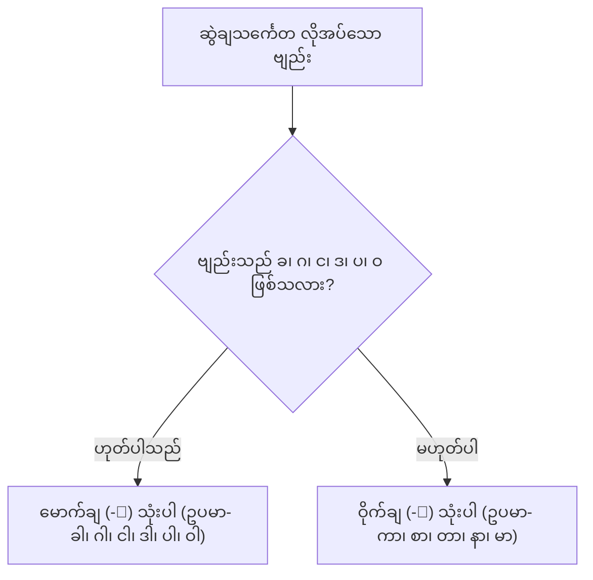
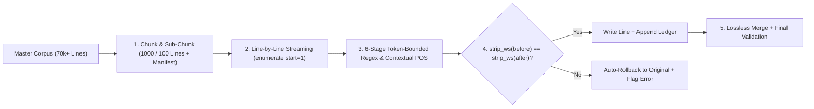

# မြန်မာသဒ္ဒါ လက်တွေ့အသုံးချ ပုံစံတမ်းများ (Applied Grammar Patterns)

## ၁။ ဝါကျခွဲခြမ်းစိတ်ဖြာခြင်း ပုံစံတမ်း (Sentence Parsing Pattern)
**အသုံးပြုရမည့် အခြေအနေ**: ရှုပ်ထွေးသော ဝါကျရှည်များကို သဒ္ဒါနည်းကျ အနက်ရှင်းလင်းအောင် ခွဲစိတ်စစ်ဆေးလိုသည့်အခါ။

### လုပ်ဆောင်နည်း အဆင့်ဆင့်:
1. **ပင်မကြိယာကို အရင်ရှာပါ**: ဝါကျကို အဆုံးသတ်ထားသော ပင်မကြိယာနှင့် ၎င်း၏ ကာလပြဝိဘတ်ကို ရှာပါ။
2. **ကတ္တားကို ရှာပါ**: "မည်သူက/အဘယ်အရာက ပြုလုပ်သနည်း" ဟု ကြိယာကို မေးခွန်းထုတ်၍ ကတ္တားဝိဘတ် (သည်၊ က) ပါသော နာမ်ပုဒ်ကို ရှာပါ။
3. **ကံပုဒ်ကို ရှာပါ**: "အဘယ်အရာကို ပြုလုပ်သနည်း" ဟု မေးခွန်းထုတ်၍ ကံဝိဘတ် (ကို) ပါသော နာမ်ပုဒ်ကို ရှာပါ။
4. **အထူးပြုပုဒ်များနှင့် အမှီဝါကျကဏ္ဍများကို ခွဲခြားပါ**:
   - နာမ်ကို အထူးပြုနေလျှင် -> နာမဝိသေသနဝါကျကဏ္ဍ (-သော)
   - ကြိယာကို အထူးပြုနေလျှင် -> ကြိယာဝိသေသနဝါကျကဏ္ဍ (-သဖြင့်၊ -သောအခါ၊ -သော်လည်း)

```
[အမှီဝါကျကဏ္ဍများ] + [ကတ္တားပုဒ်စု] + [ကံပုဒ်စု] + [ကြိယာဝိသေသန] + [ပင်မကြိယာ]
```

---

## ၂။ မောက်ချ/ဝိုက်ချ မှန်ကန်မှု စစ်ဆေးခြင်း ပုံစံတမ်း (Tone Mark Validation Pattern)
**အသုံးပြုရမည့် အခြေအနေ**: မြန်မာစာလုံးပေါင်း သတ်ပုံစစ်ဆေးသည့်အခါ ဆွဲချသင်္ကေတ အမှားအယွင်း ကင်းစင်စေရန်။

### ဆုံးဖြတ်ချက် လမ်းညွှန် (Decision Logic):


---

## ၃။ စကားသံပြောင်းလဲမှု ခန့်မှန်းခြင်း ပုံစံတမ်း (Voicing Prediction Pattern)
**အသုံးပြုရမည့် အခြေအနေ**: စာလုံးပေါင်းမှန်သော်လည်း အသံထွက်ရာတွင် သဘာဝကျသော အသံထွက်အမှန်ကို သိရှိလိုသည့်အခါ (TTS / Speech Synthesis / ဖတ်ကြားမှု)။

### အဆင့်ဆင့် စစ်ဆေးပုံ:
1. ရှေ့စကားလုံး၏ အဆုံးသံကို ကြည့်ပါ:
   - သရသံလွတ် ဖြစ်နေသလား? (ဥပမာ- ရွှေ၊ စာ၊ လူ)
   - နှာသတ်သံ (င်၊ န်၊ မ်) ဖြစ်နေသလား? (ဥပမာ- ကျောင်း၊ သင်၊ မင်း)
2. နောက်လိုက်စကားလုံး၏ အစဗျည်းသည် သိထိလ/ဓနိတ (က၊ ခ၊ စ၊ ဆ၊ တ၊ ထ၊ ပ၊ ဖ) ဖြစ်နေသလား?
3. အကယ်၍ ဟုတ်ပါက အသံပျော့ (ဂ၊ ဇ၊ ဒ၊ ဗ) သို့ ပြောင်းလဲထွက်ဆိုပါ:
   - က၊ ခ -> [ဂ]
   - စ၊ ဆ -> [ဇ]
   - တ၊ ထ -> [ဒ]
   - ပ၊ ဖ -> [ဗ]
4. ရှေ့စကားလုံးသည် ရပ်တန့်သတ် (က်၊ စ်၊ တ်၊ ပ်) ဖြစ်ပါက အသံမပြောင်းဘဲ မူလအတိုင်း ထွက်ပါ။

---

## ၄။ ပုဒ်ဖွဲ့စည်းတည်ဆောက်ပုံ ခွဲခြမ်းစိတ်ဖြာခြင်း ပုံစံတမ်း (Morphology Decomposition Pattern)
**အသုံးပြုရမည့် အခြေအနေ**: စကားလုံးတစ်ခု၏ သဒ္ဒါဖွဲ့စည်းပုံကို သုတေသနပြုသည့်အခါ။

| အဆင့် | စစ်ဆေးရမည့် အချက် | ရလဒ် | ဥပမာ |
|---|---|---|---|
| ၁ | စကားလုံးကို ထပ်မံခွဲစိတ်၍ မရတော့ဘူးလား? | **ပုဒ်ရိုး (Root)** | လူ၊ ရေ၊ သွား |
| ၂ | သီးခြားအနက်ရှိသော ပုဒ်ရိုး ၂ ခု ပေါင်းထားသလား? | **ပေါင်းစပ်ပုဒ် (Compound)** | ရေ + အိုး = ရေအိုး |
| ၃ | 'အ-' ရှေ့ဆက် သို့မဟုတ် '-ခြင်း' စသော ပစ္စည်းပါသလား? | **ပစ္စည်းရောပုဒ် (Derived)** | အသောက်၊ စားခြင်း |
| ၄ | 'သည်၊ ကို၊ ၏၊ သို့' စသော ဝိဘတ်များ သွယ်ဆက်ထားသလား? | **ဝိဘတ်သွယ်ပုဒ် (Inflected)** | ကျောင်းသို့၊ သူသည် |

---

## Legal70k annotation တွင် အသုံးပြုရန်

ဤဖိုင်၏ morphology decomposition သည် reference grammar analysis ဖြစ်ပြီး flat WS token ခွဲပုံကို အလိုအလျောက် မသတ်မှတ်ပါ။ Legal70k အတွက် [Cheatsheet အပိုင်း ၆–၁၀](cheatsheet.md#corpus-rules) ရှိ owner-specific စံကို တွဲသုံးပါ။ Lexicalized compound/contextual tag၊ component ခွဲပုံ၊ သီးခြား reconstructable bracket layer နှင့် record-only typo policy ကို မရောထွေးပါနှင့်။ Original spelling/codepoints ထိန်း၍ မဆုံးဖြတ်နိုင်သော context ကို review စာရင်းတွင်ထားပါ။

---

## ၅။ Contextual POS Disambiguation ပုံစံတမ်း (NLP Tagging Decision Pattern)
**အသုံးပြုရမည့် အခြေအနေ**: စာလုံးပေါင်းတူသော်လည်း ဝါကျအတွင်း တာဝန်ကွဲပြားသော ပုဒ်များ (`ပေး/သွား`, `နှင့်/နဲ့`, `က`, `သည်`, `ရာ`, `ဖြစ်စေ`, `တစ်စုံတစ်ရာ`) ကို 15-tag `myPOS` စနစ်ဖြင့် အညွှန်းတပ်သည့်အခါ ([POS & UD Mapping](references/pos-ud-mapping.md) ကို တွဲကြည့်ပါ)။

### ဆုံးဖြတ်ချက် အဆင့်ဆင့်:
1. **Owner Fixed-Tag စစ်ဆေးခြင်း**: `တမျိုးတည်း/adj`, `တဖက်သတ်/adv`, `တဆက်တည်း/adv`, `တဦးတည်းပိုင်/adj`, `တချိန်တည်း/adv`, `တပြိုင်နက်/adv`, `တခါတရံ/adv`, `အခါတမျိုးမျိုး/adv`, `တချက်လွှတ်/adj`, `တကျွန်းပို့ဒဏ်/n`, `တသီးတခြား/adv` တို့ဖြစ်ပါက သတ်မှတ်ထားသော fixed tag ကို တိုက်ရိုက်သုံးပါ။
2. **`ဆိုသည်မှာ` နှင့် `သည်` သုံးမျိုး ခွဲခြားစစ်ဆေးခြင်း**:
   - **နာမ်ထောက်ပစ္စည်း (`သည်/part`)**: `ဆို/v သည်/part မှာ/ppm` တွင် `သည်` သည် ကြိယာ (`ဆို/v`) ကို နာမ်အသွင်ပြောင်း (nominalize) ပေးသော ပစ္စည်း (`/part`) ဖြစ်ပြီး၊ ၎င်းနောက်မှ `မှာ` သည် ကတ္တား/အကြောင်းအရာပြ ဝိဘတ် (`/ppm`) ဖြစ်သည် (`သည်/ppm` သို့မဟုတ် `မှာ/part` လုံးဝ မသုံးရ)။
   - **ဝါကျအဆုံးသတ် ကာလပြပစ္စည်း (`သည်/part`, `မည်/part`)**: ကြိယာ သို့မဟုတ် ကူကြိယာနောက်၌ ဝါကျ/ဝါကျကဏ္ဍ အဆုံးသတ်သည့် `သည်` နှင့် `မည်` တို့သည် `/part` ဖြစ်သည် (`ဆောင်ရွက်/v ပေး/part သွား/part မည်/part ။/punc`)။
   - **ကတ္တားဝိဘတ် (`သည်/ppm`)**: နာမ်၊ နာမ်စား သို့မဟုတ် အများကိန်း/အရေအတွက်ပြပစ္စည်း (`တို့/part`, `များ/part`, `လုံး/part`, `တိုင်း/part`) နောက်မှ လိုက်သော `သည်` သည် ကတ္တားဝိဘတ် (`/ppm`) ဖြစ်သည် (`နိုင်ငံသား/n တိုင်း/part သည်/ppm`)။
3. **`ရာ` သုံးမျိုး (`ရာ/part` vs `ရာ/n` vs `ရာ/tn`) ခွဲခြားစစ်ဆေးခြင်း**:
   - **ကြိယာနောက်ဆက် ပစ္စည်း (`ရာ/part`)**: ပြုမူဆောင်ရွက်ခြင်းကို ပြဆိုသော ကြိယာ (`[V]` သို့မဟုတ် `[V] + ကြ/part`) နောက်တွင် လိုက်သည့် `[V] + ရာ + တွင်/၌/မှ` (`ဆောင်ရွက်/v ရာ/part တွင်/ppm`၊ `တင်ပြ/v ရာ/part တွင်/ppm`၊ `ရောင်းချ/v ရာ/part တွင်/ppm`၊ `ဆုံးဖြတ်/v ရာ/part ၌/ppm`)၊ `[V] + ရာ + ရောက်/v` (`ကျူးလွန်/v ရာ/part ရောက်/v`)၊ `[V1] + ရာ + [V1] + ကြောင်း` (`ပျက်စီး/v ရာ/part ပျက်စီး/v ကြောင်း/part`) နှင့် `[V] + ရာ + [N]` (`ပြန့်/v ရာ/part နယ်မြေ/n`၊ `စုဝေး/v ရာ/part နေရာ/n`) တို့တွင် `ရာ` သည် ပစ္စည်း (`/part`) သဘောကို ဆောင်သည် (`/v` သို့မဟုတ် `/n` လုံးဝ မသုံးရ)။
   - **တည်ရာ/အရာဝတ္ထုပြ နာမ် (`ရာ/n`)**: နေရာ၏ `ရာ`၊ အရာဝတ္ထု၏ `ရာ` ကို ပြဆိုသော နာမ်ပုဒ်များ (`နေရာ/n`၊ `အရာ/n`၊ `ရိုက်ရာ/n`) တွင် နာမ် (`/n`) ဖြစ်သည်။
   - **သင်္ချာနာမ် (`ရာ/tn`)**: ကိန်းဂဏန်း ၁၀၀ ကို ပြဆိုသောအခါ (`တ/tn ရာ/tn`၊ `နှစ်/tn ရာ/tn`၊ `သုံး/tn ရာ/tn`) တွင် `/tn` ဖြစ်သည်။
4. **ကြိယာတွဲ (`V + ပေး/သွား/လာ/ထား/နေ/ခဲ့/ပြီး/လိုက်`) စစ်ဆေးခြင်း**:
   - ရှေ့တွင် ပင်မကြိယာ (`v`) ရှိပြီး ကူကြိယာအဖြစ် လိုက်ပါက -> `part` (`ဆောင်ရွက်/v ပေး/part သွား/part မည်/part`)။
   - ဝါကျ/ဝါကျကဏ္ဍ၏ ပင်မကြိယာ ဖြစ်ပါက -> `v` (`သူ့/pron အား/ppm စာအုပ်/n ပေး/v သည်/part`)။
5. **`နှင့် / နဲ့`၊ `က`၊ စကားကိုး `ဟု/ဟူ၍/ဟူသော/ဟူသည်` နှင့် ပုဒ်မခွဲ `( က )` စစ်ဆေးခြင်း**:
   - `NP1 နှင့် NP2` (နာမ်ချင်းဆက်) -> `conj`၊ `NP နှင့် V` (အသုံးခံ/အတူတကွ) -> `ppm`၊ ဝါကျအဆုံး `နဲ့` -> `part`။
   - `NP က` (ကတ္တား/ထွက်ခွာရာ) -> `ppm`၊ `V (ပါ) က` ("အကယ်၍ ... လျှင်" အနက်) -> `conj`၊ လက်သည်းကွင်းအတွင်း ပုဒ်မခွဲ `(/punc က/sb )/punc` -> `sb` (လက်သည်းကွင်းပြင်ပရှိ `က`၊ `ရ`၊ `စ` တို့ကို `/sb` လုံးဝ မပေးရ၊ လက်သည်းကွင်းအတွင်းရှိ လက်တင်ဥပဒေပုဒ် `Mandamus/fw` နှင့် မြို့အမည်ကွဲ `ပန်ခမ်း/n` တို့ကို `/sb` မပေးရ)။
   - စကားကိုးပြပစ္စည်း `ဟု`၊ `ဟူ၍`၊ `ဟူသော`၊ `ဟူသည်` -> အမြဲတမ်း `part`။
6. **ကိန်းဂဏန်း (`num` vs `tn`) နှင့် အဆင့်ပြကိန်း vs ဒသမကိန်း (`adj` vs `n`) စစ်ဆေးခြင်း**:
   - မြန်မာဂဏန်းသင်္ကေတ (`၁၊ ၂၊ ၁၀၀`) -> `num`။
   - စာလုံးပေါင်းကိန်း (`တ၊ တစ်၊ နှစ်၊ သုံး၊ သုံးဆယ်၊ နှစ်ဆယ့်ငါး၊ တစ်ထောင်`) -> `tn` (`နှစ်` = year ဖြစ်လျှင် `n`၊ `သုံး` = use ဖြစ်လျှင် `v`)။
   - အဆင့်ပြကိန်း (`ပထမ၊ ပဌမ၊ ဒုတိယ၊ တတိယ၊ စတုတ္ထ ...`) -> `adj` ဖြစ်သော်လည်း ဒသမကိန်းအမှတ် (`သုည/tn ဒသမ/n တစ်/tn ရာခိုင်နှုန်း/n`) တွင် `ဒသမ` သည် နာမ် (`n`) ဖြစ်သည်။
7. **မရေတွက်နိုင်သော ပမာဏပြစကားလုံး (`-ပေါင်းများစွာ`) နှင့် စုပေါင်းနာမ် (`[Noun]ပေါင်း + Numeral`) စစ်ဆေးခြင်း**:
   - `[X]ပေါင်းများစွာ` (`ရာပေါင်းများစွာ`၊ `ထောင်ပေါင်းများစွာ`၊ `သန်းပေါင်းများစွာ`၊ `နှစ်ပေါင်းများစွာ`၊ `လပေါင်းများစွာ`၊ `ဒါဇင်ပေါင်းများစွာ`၊ `ရာစုနှစ်ပေါင်းများစွာ`) -> ပုဒ်တစ်ခုတည်း (Single Token) ဖြစ်ရမည်။ ကာလပြ/ကြိယာထူးပြုလျှင် `adv`၊ နာမ်ထူးပြုလျှင် `adj`၊ ဝိဘတ်ကပ်ပဓာနနာမ်ဖြစ်လျှင် `n`။ (❌ `သန်းပေါင်း/n များစွာ/adv` သို့မဟုတ် `များ/part စွာ/part` မခွဲရ)။
   - `[Noun]ပေါင်း + Numeral` (`ရက်ပေါင်း/n ၁၀၀/num`၊ `နှစ်ပေါင်း/n ၁၂၅/num`၊ `လူပေါင်း/n ၃၅၀/num`၊ `အဖွဲ့အစည်းပေါင်း/n ၁၀၀/num`၊ `နိုင်ငံပေါင်း/n ၃၉/num`၊ `ပစ်မှတ်ပေါင်း/n ၈၀/num`၊ `တိုက်ပွဲပေါင်း/n ၁၀၀/num`၊ `အမှုပေါင်း/n ၅၀၀/num`) -> `ပေါင်း` သည် နာမ်နှင့် တစ်ပေါင်းတည်း `[Noun]ပေါင်း/n` ဖြစ်ရမည်။ (❌ `တိုက်ပွဲ/n ပေါင်း/part ၁၀၀/num` မခွဲရ)။

---

## ၆။ Dependency Parsing (`CoNLL-U`) နှင့် NER Span တည်ဆောက်ပုံ ပုံစံတမ်း
**အသုံးပြုရမည့် အခြေအနေ**: ဝါကျတစ်ကြောင်းကို Universal Dependencies (`HEAD`, `DEPREL`) သို့မဟုတ် Named Entity Recognition (`PER`, `ORG`, `LOC`, `GPE`, `DATE`) အဖြစ် ပြောင်းလဲသည့်အခါ ([Downstream NLP Guide](references/downstream-nlp-guide.md) ကို ကြည့်ပါ)။

### (က) SOV Dependency Attachment Pattern:
```text
[မောင်မောင်/n] <--case-- [သည်/ppm]
      |
      +----nsubj----> [ဖတ်/v (ROOT=0)] <--aux/mark-- [ခဲ့/part] <--mark-- [သည်/part]
                            ^
[စာအုပ်/n] <--case-- [ကို/ppm] |
      |_____________________| (obj)
```
- **နာမ်ဝိဘတ် (`ppm`)**: ရှေ့နာမ် (`n`/`pron`) ကို Head အဖြစ် Leftward (`case`) ချိတ်သည်။
- **ကူကြိယာနှင့် ဝါကျအဆုံးသတ် ကာလပြပစ္စည်း (`part`)**: ပင်မကြိယာ (`v`) ကို Head အဖြစ် Leftward (`aux`/`mark`) ချိတ်သည်။
- **နာမဝိသေသနဝါကျကဏ္ဍ (`V + သော/သည့်/တဲ့ + N`)**: ရှေ့ကြိယာက နောက်နာမ်ကို Rightward (`acl`) ချိတ်ပြီး `သော/သည့်/တဲ့` က ရှေ့ကြိယာကို Leftward (`mark`) ချိတ်သည်။

### (ခ) NER Span Boundary Pattern:
- **လူအမည် (`PER`)**: `[ဦးအေးမောင်/n]_PER သည်/ppm`, `[ဒေါ်အောင်ဆန်းစုကြည်/n]_PER`, `[စဝ်စံထွန်း/n]_PER`, `သံအမတ်ကြီး/n [ဦးကျော်မိုးထွန်း/n]_PER` — လူမှုရေးနှင့် တိုင်းရင်းသား အမည်ရှေ့ဆက် (`ဦး`, `ဒေါ်`, `ကို`, `မ`, `စဝ်`, `စော`, `နော်`) ကို အမည်နှင့် မခွဲဘဲ တစ်ပုဒ်တည်း (`/n`) သတ်မှတ်သည်။ ရာထူး၊ အဆင့်အတန်းနှင့် ဘွဲ့ထူးဂုဏ်ပုဒ် (`သံအမတ်ကြီး`, `ဗိုလ်ချုပ်ကြီး`, `စော်ဘွားကြီး`, `ဒေါက်တာ`, `သမ္မတ`) ကိုသာ သီးခြား `/n` ခွဲထုတ်သည်။ နောက်ဆက် ဝိဘတ် `သည်/က/ကို/အား` တို့ကို Entity Span အပြင်ဘက်တွင် ထားရမည်။
- **ဒေသနှင့် အဖွဲ့အစည်း (`GPE` / `ORG`)**: `[ရခိုင်/n ပြည်နယ်/n]_GPE`၊ `[ပြည်နယ်/n အစိုးရ/n အဖွဲ့/n]_ORG က/ppm` — နောက်ဆက် ဝိဘတ် `က/၏/မှ/သို့` ကို Entity Span အပြင်ဘက်တွင် ထားရမည်။

---

## ၇။ Corpus-Wide ပြင်ဆင်မှုနှင့် Blast-Radius စစ်ဆေးခြင်း ပုံစံတမ်း
**အသုံးပြုရမည့် အခြေအနေ**: စာကြောင်းတစ်ကြောင်းတွင် တွေ့ရှိသော ပုဒ်ဖြတ်/POS အမှားတစ်ခုကို Corpus တစ်ခုလုံးသို့ စည်းမျဉ်းအဖြစ် ချဲ့ထွင်သက်ရောက်လိုသည့်အခါ ([Segmentation & Lexicon Reference](references/segmentation-lexicon.md) ကို ကြည့်ပါ)။

### အဆင့်ဆင့် စစ်ဆေးပုံ:
1. **Character Conservation စစ်ဆေးခြင်း**: ပြင်ဆင်မှု မတိုင်မီနှင့် ပြင်ဆင်ပြီးနောက် whitespace ဖယ်ထုတ်ထားသော အက္ခရာစဉ် (`re.sub(r"\s+", "", text)`) တစ်ထပ်တည်း ဖြစ်ရမည်။
2. **Scope နှင့် Counterexample တွက်ချက်ခြင်း**:
   - **S0 (Single Line)** vs **S1 (Exact Lexeme Match)** vs **S2/S3 (Pattern/Wildcard)** ကို ခွဲခြားပါ။
   - ဥပမာ `ကရင် နီနယ်` -> `ကရင်နီ နယ်` ကို S1 အတိအကျဖြင့်သာ ပြင်ရမည် (S2 `[State] + *နယ်` ဟု ရေးပါက မှန်ကန်ပြီးသား `ကချင် ပြည်နယ်`၊ `မွန် ပြည်နယ်` ထောင်ပေါင်းများစွာ ပျက်စီးမည်)။
3. **Validator Script ဖြင့် အတည်ပြုခြင်း**:
   ```bash
   python3 scripts/validate_nlp_corpus.py --input <output_file> --reference <orig_file> --mode pos
   ```

---

## ၈။ ဖိုင်ကြီးမားသော Corpus အား Chunk ခွဲခြင်း၊ Line-by-Line စစ်ဆေးခြင်းနှင့် 6-Stage Regex ပြင်ဆင်ခြင်း ပုံစံတမ်း
**အသုံးပြုရမည့် အခြေအနေ**: စာကြောင်းရေ သောင်း/သိန်းချီရှိသော Corpus ဖိုင်ကြီးများကို Memory မပြည့်စေဘဲ (Constant $O(1)$ RAM per line)၊ LLM output မပြတ်တောက်စေဘဲ အဆင့်လိုက် စစ်ဆေးပြင်ဆင်လိုသည့်အခါ ([Large-Corpus Chunking & Regex Guide](references/large-corpus-chunking-and-regex-pipeline.md) ကို ကြည့်ပါ)။

### လုပ်ဆောင်နည်း အဆင့်ဆင့်:


1. **အဆင့် ၁ - Deterministic Chunking**:
   ```bash
   python3 scripts/corpus_chunk_and_remediate.py chunk \
     --input corpus_ws.txt --outdir chunks_out --chunk-size 1000 --subchunk-size 100
   ```
2. **အဆင့် ၂ - Line-by-Line 6-Stage Regex Remediation (Dry-Run ဖြင့် အရင်စမ်းသပ်ရန်)**:
   ```bash
   # Preview changes without modifying files
   python3 scripts/corpus_chunk_and_remediate.py remediate \
     --input chunks_out/chunk_0001_lines_000001_001000.txt --mode ws --dry-run

   # Apply 6-stage remediation with TSV change ledger and record-only typo log
   python3 scripts/corpus_chunk_and_remediate.py remediate \
     --input chunks_out/chunk_0001_lines_000001_001000.txt \
     --output chunks_out/chunk_0001_lines_000001_001000.txt \
     --mode ws \
     --ledger chunks_out/chunk_0001_ledger.tsv \
     --record-only-log chunks_out/chunk_0001_record_only.jsonl
   ```
3. **အဆင့် ၃ - Lossless Merge နှင့် Final Validation**:
   ```bash
   python3 scripts/corpus_chunk_and_remediate.py merge \
     --manifest chunks_out/manifest.json --output corpus_ws_remediated.txt --reference corpus_ws.txt
   python3 scripts/validate_nlp_corpus.py \
     --input corpus_ws_remediated.txt --reference corpus_ws.txt --mode ws
   ```


---

## ၉။ Target Words, Collateral Damage (Blast Radius) နှင့် Regression Safeguards ပုံစံတမ်း
**အသုံးပြုရမည့် အခြေအနေ**: Word Segmentation နှင့် POS Annotation ပြင်ဆင်မှုများ ပြုလုပ်ရာတွင် စည်းမျဉ်းတစ်ခုအား သက်ရောက်လိုက်ခြင်းကြောင့် အခြားစကားလုံးများ ထိခိုက်ပျက်စီးမှု (Blast Radius) မဖြစ်ပေါ်စေရန်နှင့် စည်းမျဉ်းများ တညီတညွတ်တည်း ဖြစ်စေရန်။

### (က) Target Words & Blast Radius Matrix (ထိခိုက်နိုင်မှု စကားလုံးများနှင့် ကာကွယ်မှု နည်းလမ်းများ)

| တွေ့ရှိရသော စကားလုံး | ပြုလုပ်လိုသော ပြင်ဆင်ချက် | အခြား ထိခိုက်ပျက်စီးနိုင်ခြေရှိသော စကားလုံးများ (Blast Radius) | ကာကွယ်ရမည့် နည်းလမ်း (Safeguard) |
|---|---|---|---|
| **မြန်မာနိုင်ငံ** | `မြန်မာ/n နိုင်ငံ/n` သို့ ခွဲခြင်း | `မြန်မာနိုင်ငံသား` ➔ `မြန်မာ နိုင်ငံ သား` (သို့) `မြန်မာ နိုင်ငံသား` အဖြစ် စာလုံးပျက်စီးသွားနိုင်ခြင်း။ | Substring မဖြတ်ရ။ Complete Token Match `(?<!\S)မြန်မာနိုင်ငံ(?!\S)` ဖြင့်သာ ဖြတ်ရမည်။ `မြန်မာနိုင်ငံသား` ကို ကာကွယ်ရမည်။ |
| **ပြည်နယ်အစိုးရအဖွဲ့** | `ပြည်နယ် အစိုးရ အဖွဲ့` သို့ ခွဲခြင်း | `အစိုးရ` ကို အရင်ရှာဖြတ်မိပါက `ပြည်နယ် အစိုးရ အဖွဲ့ဝင်` သို့မဟုတ် `ပြည်နယ်အစိုးရ` တို့ အဆင့်ဆင့် ပျက်စီးခြင်း။ | **Longest Match First**: အရှည်ဆုံးစကားလုံး (`ပြည်နယ်အစိုးရအဖွဲ့`) ကို အရင်ဖြတ်ပြီးမှ `ပြည်နယ်အစိုးရ`၊ `အစိုးရအဖွဲ့`၊ `အစိုးရ` သို့ စစ်ဆေးရမည်။ |
| **ဘာသာသာသနာ** | `ဘာသာ/n သာသနာ/n` သို့ ခွဲခြင်း | `သာသနာရေး` ရှိ `-ရေး` ပြုတ်ထွက်သွားခြင်း (သို့) `ဗုဒ္ဓဘာသာ` မှ `ဘာသာ` ပြုတ်ထွက်သွားခြင်း။ | Exact form `(?<!\S)ဘာသာသာသနာ(?!\S)` ကိုသာ ဖြတ်ရမည်။ `သာသနာရေး` သည် ဝေါဟာရဖြစ်ပုဒ်အဖြစ် မခွဲဘဲ ကာကွယ်ရမည်။ |
| **ကရင် နီနယ်** | `ကရင်နီ နယ်` သို့ ပြင်ဆင်ခြင်း | `[State] + *နယ်` ဟု Wildcard ရေးမိပါက မှန်ကန်နေသော `ကချင် ပြည်နယ်`၊ `မွန် ပြည်နယ်`၊ `ရှမ်း ပြည်နယ်` ထောင်ပေါင်းများစွာ ပြိုကွဲပျက်စီးခြင်း။ | Wildcard လုံးဝ မသုံးရ။ S1 Exact Complete Lexeme Match အဆင့်ဖြင့်သာ သက်ရောက်စေရမည်။ |
| **သမ္မတအား / တရားခံအား** | Dative `အား/ppm` ကို နာမ်မှ ခွဲထုတ်ခြင်း (`သမ္မတ အား`) | ဝေါဟာရတွင်းရှိ နာမ်ပုဒ်များဖြစ်သော `ဖိအား`, `ဓာတ်အား`, `အင်အား`, `စွမ်းအား`, `လုပ်အား` တို့ အလယ်မှ ပြိုကွဲခွဲထုတ်ခံရခြင်း။ | အဘိဓာန်ဝင် `အား` စကားလုံးများ (Whitelist) အား မခွဲဘဲ အပြည့်အဝ ကာကွယ်ရမည် (Protect lexicalized nouns)။ |
| **ပေါ်ပေါက်လာ / ဖြစ်ပွားသွား** | ကူကြိယာ `လာ/သွား` အား ခွဲထုတ်ခြင်း (`ပေါ်ပေါက် လာ`) | ပေါင်းစပ်ကြိယာနှင့် ဝေါဟာရနာမ်များဖြစ်သော `ခရီးသွား`, `သွားလာ` တို့ ခွဲထုတ်ခံရပြီး အနက်ပျက်ခြင်း။ | Directional Auxiliary စစ်ဆေးရာတွင် `ခရီးသွား`၊ `သွားလာ` ကဲ့သို့သော Lexeme များကို Exemption List ထဲ ထည့်သွင်းရမည်။ |
| **လျှောက်ထားသူ / ကြီးကြပ်သူ** | Relative Clause Agent `သူ/pron` အား ခွဲထုတ်ခြင်း (`လျှောက်ထား သူ`) | အဘိဓာန်ဝင် သာမညနာမ်များဖြစ်သော `ပြည်သူ`, `တောင်သူ`, `စားသုံးသူ`, `ကျောင်းသူ`, `ရန်သူ`, `ချစ်သူ` တို့ ပြိုကွဲသွားခြင်း။ | Productive `V + သူ` ကိုသာ ခွဲပြီး Lexicalized `Noun + သူ` စာရင်းအား အခိုင်အမာ ကာကွယ်ထားရမည် (Never split lexicalized nouns)။ |
| **မပြိုကွဲရေး / မပျက်စီးရေး** | အငြင်းပုဒ် `မ` အား ခွဲထုတ်ခြင်း (`မ ပြိုကွဲရေး`) | အဘိဓာန်ဝင် အငြင်းအနက် ဝေါဟာရများဖြစ်သော `မတရား`, `မတော်တဆ`, `မသန်မစွမ်း`, `မသင့်မလျော်`, `မတိုင်မီ`, `အခန်းမ` တို့ ထိခိုက်ခြင်း။ | Pre-verbal Negation `မ` သီးသန့် ဖြစ်မှသာ ခွဲပြီး Idiomatic `မ-` စာရင်းကို Exemption ပေးထားရမည်။ |
| **ပို၍ / ဆက်လက်၍** | ကပ်နေသော `၍` အား ခွဲထုတ်ခြင်း (`ပို ၍`, `ဆက်လက် ၍`) | ပေါင်းစပ်ဆက်သွယ်ပုဒ်များဖြစ်သော `ဟူ၍`, `အကယ်၍` တို့ ပြိုကွဲခွဲထုတ်ခံရခြင်း။ | Lookaround ဖြင့် `(?!ဟူ၍|အကယ်၍)` ဟု Negative Lookahead ထည့်သွင်းရမည်။ |
| **ဦးမင်းအောင်လှိုင် / ဒေါ်အောင်ဆန်းစုကြည်** | လူနာမည် အပြည့်အစုံ | နာမည်ရှေ့ဆက် `ဦး`, `ဒေါ်` အား ခွဲထုတ်မိပါက `ဦး/part` ဖြစ်သွားပြီး NER / Syntax ပျက်စီးခြင်း။ အပြန်အလှန်အားဖြင့် `ဦး` ကို မခွဲဘဲ ဇွတ်ကပ်ပါက `၁ ဦး/part`၊ `တစ် ဦး/part` (မျိုးပြပစ္စည်း) နှင့် ရောထွေးခြင်း။ | **Strict Standard**: လူမှုရေး/တိုင်းရင်းသား အမည်ရှေ့ဆက် (`ဦး`, `ဒေါ်`, `ကို`, `မ`, `စဝ်`, `စော`, `နော်`) သည် အမည်နှင့် တစ်ဆက်တည်း `1 Token /n` ဖြစ်ရမည်။ ဂဏန်းနောက်မှ `ဦး` သည်သာ `part` ဖြစ်သည်။ |
| **ဗိုလ်ချုပ်အောင်ဆန်း / သံအမတ်ကြီးဦးကျော်မိုးထွန်း** | ရာထူးနှင့် အမည်တွဲ | ရာထူးကို မခွဲဘဲထားပါက NER span ပျက်စီးခြင်း (Zero-Clitic & Title Rule ချိုးဖောက်မိခြင်း)။ | ရာထူး/ဘွဲ့ထူး/အဆင့်အတန်း (`ဗိုလ်ချုပ်`, `ဗိုလ်ကြီး`, `သံအမတ်ကြီး`, `စော်ဘွားကြီး`, `ဒေါက်တာ`, `သမ္မတ`) ကို သီးခြား `/n` အဖြစ် အမည်ရှေ့မှ အမြဲ ခွဲထုတ်ရမည်။ |
| **သန်းပေါင်းများစွာ / ရက်ပေါင်း ၁၀၀** | အရေအတွက် ပေါင်းစပ်စကားလုံး | `သန်းပေါင်း/n များစွာ/adv` (သို့) `များ/part စွာ/part` ဟု အပိုင်းပိုင်း ပြိုကွဲခွဲထုတ်မိခြင်း။ | `[X]ပေါင်းများစွာ` သည် Single Token ဖြစ်ရမည်။ `[Noun]ပေါင်း + Numeral` တွင် `[Noun]ပေါင်း/n` သည် တစ်ပုဒ်တည်း ဖြစ်ရမည် (`တိုက်ပွဲပေါင်း/n ၁၀၀/num`)။ |

### (ခ) Boundary-Shift Traps အမြန်စစ်ဆေးချက် ဇယား

1. `အများ ကလေး စား ထိုက်` ➔ **အမှန်**: `အများ က လေးစား ထိုက်` (`က` = ကတ္တားဝိဘတ် `ppm`, `လေးစား` = ကြိယာ `v`, `ကလေး` child မဟုတ်)
2. `စစ်ဆေး ခြင်း ခံ ရ သူမ ဟုတ် ဘဲ` ➔ **အမှန်**: `စစ်ဆေး ခြင်း ခံ ရ သူ မ ဟုတ် ဘဲ` (`သူ` = agent `part`, `မ` = negation `part`, `သူမ` she မဟုတ်)
3. `သက်ဆိုင်ရာ ဥပဒေ အရသာ` ➔ **အမှန်**: `သက်ဆိုင်ရာ ဥပဒေ အရ သာ` (`အရ` according to, `သာ` only, `အရသာ` taste မဟုတ်)
4. `လွှတ်တော် အစည်းအဝေးခန်း မ` ➔ **အမှန်**: `လွှတ်တော် အစည်းအဝေး ခန်းမ` (`ခန်းမ` hall noun, `မ` negation မဟုတ်)
5. `တာဝန် ယူဆောင် ရွက်` ➔ **အမှန်**: `တာဝန် ယူ ဆောင်ရွက်` (`တာဝန် ယူ` + `ဆောင်ရွက်`, `ယူဆောင်` bring မဟုတ်)
6. `ခေတ္တရပ် စောင့် နေ စဉ်` ➔ **အမှန်**: `ခေတ္တ ရပ် စောင့် နေ စဉ်` (`ခေတ္တ` briefly + `ရပ်` stop, `ခေတ္တရပ်` မဟုတ်)

### (ဂ) အနာဂတ်အတွက် စံပြု Safeguard Protocol
1. **Precedence Hierarchy (ဦးစားပေး အဆင့်ဆင့်)**:
   $$\text{Orthographic Fidelity} > \text{Owner Rules / Lexicon} > \text{Morphosyntactic Chains} > \text{General Rules}$$
2. **Blast-Radius Pre-Simulation**:
   Corpus တစ်ခုလုံးသို့ စည်းမျဉ်းတစ်ခု မချဲ့ထွင်မီ `fixes` နှင့် `blocks` (counterexamples) ကို စစ်ဆေးပါ။ `blocks > 0` ဖြစ်ပါက Exception List မပါဘဲ Global Rule လုံးဝ မချဲ့ထွင်ရ။
3. **Character Conservation Rollback**:
   ပြင်ဆင်မှုတိုင်းတွင် `re.sub(r"\s+", "", before) == re.sub(r"\s+", "", after)` မဖြစ်ပါက အလိုအလျောက် Rollback ပြန်ဆွဲရမည်။
