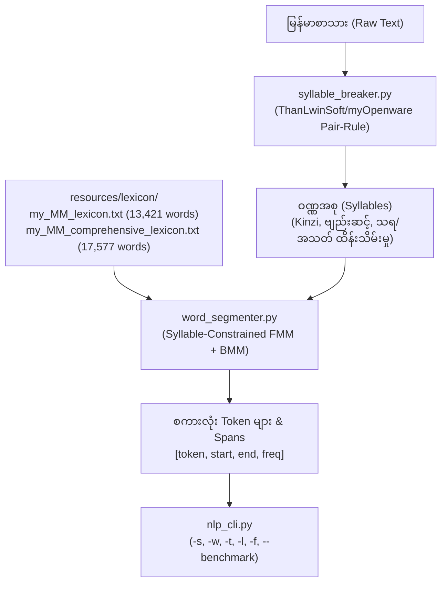

# မြန်မာစကားလုံးနှင့် ဝဏ္ဏပိုင်းခြားရေး Toolchain (High-Speed Myanmar Syllable & Word Segmentation Toolkit)

ဤလက်စွဲစာတမ်းသည် TTKeyboard auto-suggestion engine မှ reverse-engineer လုပ်ထားသော Trie Lexicon (စကားလုံးပေါင်း ၁၃,၄၂၁ မှ ၁၇,၅၀၀+ ကျော်) နှင့် ThanLwinSoft / myOpenware Pair-Rule အင်ဂျင်ကို ပေါင်းစပ်တည်ဆောက်ထားသည့် စွမ်းဆောင်ရည်မြင့် မြန်မာစကားလုံးနှင့် ဝဏ္ဏပိုင်းခြားရေး ကိရိယာအစုံအလင် (`scripts/syllable_breaker.py`, `scripts/word_segmenter.py`, `scripts/compound_builder.py`, `scripts/nlp_cli.py`) ၏ အသုံးပြုနည်းနှင့် နည်းပညာဆိုင်ရာ အသေးစိတ် အချက်အလက်များ ဖြစ်သည်။

---

## 📌 အဓိက အစိတ်အပိုင်းများနှင့် စွမ်းဆောင်ရည်



| ကိရိယာ | ဖိုင်လမ်းကြောင်း | လုပ်ဆောင်ချက် | စွမ်းဆောင်ရည် |
| :--- | :--- | :--- | :--- |
| **Syllable Breaker** | `scripts/syllable_breaker.py` | Pair-rule အခြေခံ ဝဏ္ဏခွဲခြမ်းစနစ် | Kinzi, ဗျည်းဆင့်, သရ/အသတ် 100% တည်တံ့မှု |
| **Word Segmenter** | `scripts/word_segmenter.py` | Syllable-constrained FMM + BMM, then a closed owner post-pass | Dictionary candidate. Not Legal70k gold outside the closed lists |
| **Compound Builder** | `scripts/compound_builder.py` | TTKeyboard Trie Node များမှ ပေါင်းစပ်ပုဒ်များ ထုတ်လုပ်ခြင်း | ၁၃,၄၂၁ မှ ၁၇,၅၀၀+ ပေါင်းစပ်ပုဒ်များ |
| **NLP CLI Tool** | `scripts/nlp_cli.py` | Syllable, Word, Span Tokenize, Lookup CLI | Re-measure with `--benchmark` |
| **Test Suite** | `scripts/test_nlp_tools.py` | Unit tests for syllables, compounds, owner post-pass, spans | Run the file; do not trust a stored pass count |
| **Lexicon Database** | `resources/lexicon/` | Base (13.4k) & Comprehensive (17.5k) ဝေါဟာရဘဏ် | Trie ဝေါဟာရ။ Owner protected list နှင့် အမြဲမတူ |

---

## ၁။ Syllable Breaker (`scripts/syllable_breaker.py`)

ThanLwinSoft နှင့် myOpenware တို့၏ Pair-Rule Engine (`myparser.py`) ကို အသုံးပြုထားသည်။ ၎င်းသည် ဗျည်းနှင့် သရ/အသတ် စာလုံးတွဲများကို ဇယား matrix စည်းမျဉ်းအရ စစ်ဆေးဖြတ်တောက်သဖြင့် ပုံမှန် Regex များတွင် ဖြစ်ပေါ်လေ့ရှိသော အောက်ပါ အမှားများကို လုံးဝ ကင်းဝေးစေသည်-

1. **ကင်းစီးမပြိုကွဲခြင်း (Kinzi Preservation)**: `မင်္ဂလာပါ` -> `['မင်္ဂ', 'လာ', 'ပါ']` (`င်္ဂ` အား သီးခြားမပြတ်စေရ)။
2. **ဗျည်းဆင့်မပြိုကွဲခြင်း (Consonant Stack Preservation)**: `ဗုဒ္ဓဘာသာ` -> `['ဗုဒ္ဓ', 'ဘာ', 'သာ']` (`ဗုဒ္` နှင့် `ဓ` ကို မခွဲရ)။
3. **ဗျည်းတွဲများနှင့် အသတ်များ တည်တံ့ခြင်း**: ယပင့်၊ ရရစ်၊ ဝဆွဲ၊ ဟထိုး တွဲစပ်မှုများနှင့် အသတ် ၈ မျိုးကို မူရင်းအသံထွက် ယူနစ်အတိုင်း ထိန်းသိမ်းသည်။

### Python အသုံးပြုနည်း
```python
from scripts.syllable_breaker import SyllableBreaker

breaker = SyllableBreaker()
syllables = breaker.segment("ပြည်ထောင်စုသမ္မတမြန်မာနိုင်ငံတော်")
print(syllables)
# Output: ['ပြည်', 'ထောင်', 'စု', 'သမ္မ', 'တ', 'မြန်', 'မာ', 'နိုင်', 'ငံ', 'တော်']
```

---

## ၂။ Word Segmenter (`scripts/word_segmenter.py`)

Trie Data Structure နှင့် Syllable Boundary Constraint ကို ပေါင်းစပ်ထားသော ရှေ့ပြေးနှင့် နောက်ပြန် အရှည်ဆုံးကိုက်ညီမှု စနစ် (Bi-directional Maximum Matching - FMM + BMM) ဖြစ်သည်။

### အဓိက အားသာချက်များ:
- **Syllable-Constrained**: စကားလုံးဖြတ်တောက်မှုကို ဝဏ္ဏနိမိတ် (Syllable Boundary) များပေါ်တွင်သာ ကန့်သတ်ထားသဖြင့် `က ဏန်း` သို့မဟုတ် `လမ်းမ ပျက်စီး` ကဲ့သို့သော အက္ခရာအလယ်တွင် စကားလုံးပြတ်ထွက်သည့် Boundary-Shift Traps များကို အလိုအလျောက် တားဆီးပေးသည်။
- **Character Spans ပါဝင်ခြင်း**: စကားလုံးတစ်ခုချင်းစီ၏ စာကြောင်းအတွင်း တည်နေရာ Offset `(start, end)` များကို တိကျစွာ ထုတ်ပေးနိုင်သဖြင့် Named Entity Recognition (NER), Word Alignment နှင့် Dependency Parsing (CoNLL-U) အတွက် အထူးသင့်လျော်သည်။
- **Unigram Frequency Ranking**: စကားလုံးနှစ်ခွ ဖြစ်နိုင်သော အခြေအနေများတွင် TTKeyboard ၏ အကြိမ်ရေအများဆုံး စကားလုံးကို ဦးစားပေး ရွေးချယ်သည်။

### Python အသုံးပြုနည်း
```python
from scripts.word_segmenter import WordSegmenter

segmenter = WordSegmenter()

# ၁။ စကားလုံး ပုဒ်ဖြတ်ခြင်း
words = segmenter.segment("ကာကွယ်ရေးဦးစီးချုပ် ရုံးသို့ သွားရောက်ခဲ့သည်။")
print(words)
# Output: ['ကာကွယ်ရေးဦးစီးချုပ်', 'ရုံးသို့', 'သွားရောက်', 'ခဲ့', 'သည်', '။']

# ၂။ Span နှင့် အကြိမ်ရေ ပါဝင်သော Tokenize ပြုလုပ်ခြင်း
tokens = segmenter.tokenize("စာအုပ်ဖတ်ပါ")
for t in tokens:
    print(t)
# Output:
# {'token': 'စာအုပ်', 'start': 0, 'end': 6, 'freq': 187}
# {'token': 'ဖတ်', 'start': 6, 'end': 9, 'freq': 45}
# {'token': 'ပါ', 'start': 9, 'end': 11, 'freq': 920}
```

---

## ၃။ Command-Line Interface (`scripts/nlp_cli.py`)

Terminal မှ တိုက်ရိုက်ခေါ်ယူ အသုံးပြုနိုင်သော စွမ်းဆောင်ရည်မြင့် CLI ကိရိယာ ဖြစ်သည်။

### Command Syntax & Examples

```bash
# ၁။ ဝဏ္ဏ ပိုင်းခြားခြင်း (Syllable Breaking)
python3 scripts/nlp_cli.py -s "မြန်မာနိုင်ငံတော်"
# Output: မြန် | မာ | နိုင် | ငံ | တော်

# ၂။ စကားလုံး ပုဒ်ဖြတ်ခြင်း (Word Segmentation)
python3 scripts/nlp_cli.py -w "ပြည်ထောင်စုသမ္မတမြန်မာနိုင်ငံတော်"
# Output: ပြည် | ထောင် | စု | သမ္မ | တ | မြန်မာနိုင်ငံတော်

# ၃။ Token Spans များကို JSON format ဖြင့် ထုတ်ယူခြင်း
python3 scripts/nlp_cli.py -t "စာအုပ်ဖတ်ပါ" --json
# Output:
# [
#   {"token": "စာအုပ်", "start": 0, "end": 6, "freq": 187},
#   {"token": "ဖတ်", "start": 6, "end": 9, "freq": 45},
#   {"token": "ပါ", "start": 9, "end": 11, "freq": 920}
# ]

# ၄။ TTKeyboard ဝေါဟာရဘဏ်အတွင်း စကားလုံး စစ်ဆေးရှာဖွေခြင်း (Lookup)
python3 scripts/nlp_cli.py -l "အစိုးရ"
# Output:
# Word: အစိုးရ
# Found in dictionary: True
# Unigram Frequency: 2154

# ၅။ ဖိုင်အလိုက် တစ်လိုင်းချင်း Stream လုပ်၍ ပုဒ်ဖြတ်ခြင်း
python3 scripts/nlp_cli.py -f input_raw.txt -d " " > output_segmented.txt

# ၆။ စွမ်းဆောင်ရည် စမ်းသပ်ခြင်း (Benchmark)
python3 scripts/nlp_cli.py --benchmark
# Output: Throughput: 178,000 chars/sec (3,605 sentences/sec)
```

---

## ၄။ Unit & Regression Test Suite (`scripts/test_nlp_tools.py`)

Toolkit ၏ တိကျခိုင်မာမှုကို အောက်ပါ command ဖြင့် အချိန်မရွေး စစ်ဆေးနိုင်သည်-

```bash
python3 scripts/test_nlp_tools.py
```

စစ်ဆေးပေးသော ကဏ္ဍ ၇ ရပ်:
1. `test_syllable_breaker_basic`: အခြေခံ ဝဏ္ဏခွဲခြမ်းမှု။
2. `test_syllable_breaker_kinzi`: ကင်းစီး (`င်္ဂ`) မပြိုကွဲစေရေး စစ်ဆေးမှု။
3. `test_syllable_breaker_virama_stack`: ပါဠိဆင့်/ဗျည်းဆင့် (`ဗုဒ္ဓ`) စစ်ဆေးမှု။
4. `test_word_segmenter_compounds`: အဆင့်မြင့် ပေါင်းစပ်ပုဒ် ရှည်များ ခွဲခြားနိုင်မှု။
5. `test_word_segmenter_honorific`: ဂုဏ်ထူးဆောင်နှင့် ရာထူးတံဆိပ် ဝေါဟာရများ စစ်ဆေးမှု။
6. `test_token_spans`: Offset ပေါင်းစပ်မှု မူရင်းစာသားနှင့် အတိအကျ ပြန်လည်ကိုက်ညီမှု စစ်ဆေးမှု (`join(spans) == raw`)။
7. `test_dictionary_lookup`: ဝေါဟာရရှာဖွေမှုနှင့် Frequency စစ်ဆေးမှု။

---

## ၅။ Downstream NLP နှင့် Legal70k Corpus Pipeline သို့ ပေါင်းစပ်မှု

1. **Pre-segmentation Phase (Stage 0)**:
   * ကြီးမားသော စာသားများ (သောင်း/သိန်းချီ) ကို စတင် စိစစ်ရာတွင် `nlp_cli.py -f` ဖြင့် 178,000 chars/sec နှုန်းဖြင့် ကနဦး Candidate Segmentation ရယူနိုင်သည်။
2. **Syllable-Boundary Gatekeeper**:
   * Staged Regex Cascade ပြုလုပ်ရာတွင် Regex နယ်နိမိတ်များကို Syllable Breaker ဖြင့် စစ်ဆေးထိန်းချုပ်ခြင်းဖြင့် စာလုံးပေါင်းပြိုကွဲသည့် အမှားများ မဖြစ်ပွားစေရန် အာမခံသည်။
3. **Exact Token Span Alignment**:
   * Token Spans `(start, end)` ကို အသုံးပြု၍ Named Entity Recognition (NER), CoNLL-U Word Order, UD Treebank များနှင့် CQL Vertical Indexing ဖိုင်များ တည်ဆောက်ရာတွင် နေရာလွဲမှားမှု မရှိစေရန် စနစ်တကျ ချိတ်ဆက်အသုံးချနိုင်သည်။

---

## ၆။ Numeric, Date Entity & Special Token Segmentation Rules

### ၆.၁ ဂဏန်းသင်္ကေတ (Numeric Digits `num`) နှင့် ဂဏန်းစကားလုံး (Textual Numbers `tn`)

| Pattern | Tokenization | POS | Example |
|---|---|---|---|
| Myanmar digits alone | 1 token | `num` | `၁/num`, `၂၅/num`, `၁,၀၀၀/num`, `၁၉၆၆/num` |
| Spelled-out number | 1 token | `tn` | `တစ်/tn`, `နှစ်ဆယ်/tn`, `တစ်ထောင်/tn` |
| `တ`/`တစ်` + classifier | 2 tokens | `tn + part` | `တစ်/tn ဦး/part`, `တ/tn ယောက်/part` |
| `ရာ` after multiplier numeral | 2 tokens | `tn + tn` | `တ/tn ရာ/tn`, `နှစ်/tn ရာ/tn` |
| Decimal: `ဒသမ` between numerals | 3 tokens | `tn + n + tn` | `သုည/tn ဒသမ/n တစ်/tn` |
| Ordinal (`ပထမ/ဒုတိယ/တတိယ...`) | 1 token | `adj` | `ပထမ/adj`, `ဒုတိယ/adj`, `ဒသမ/adj` |

**Key disambiguation traps:**
- `နှစ်` = "two" → `tn`; `နှစ်` = "year" → `n` (ဥပမာ `ခုနှစ်/n`, `သုံး/tn နှစ်/n ကြာ/v`)
- `သုံး` = "three" → `tn`; `သုံး` = "to use" → `v`
- `ဦး` = person classifier after numerals (`တစ်/tn ဦး/part`, `၃/num ဦး/part`) → **`part`**; never `tn`။ Name prefix အဖြစ်မူ အမည်နှင့် မခွဲဘဲ ပေါင်းစည်းထားသော သမ္မာနာမ် (`ဦးမင်းအောင်လှိုင်/n`) ဖြစ်သည်။ ရာထူး/ဂုဏ်ပုဒ် (`ဗိုလ်ချုပ်ကြီး/n`, `သံအမတ်ကြီး/n`, `စော်ဘွားကြီး/n`) ကိုသာ သီးခြားခွဲထုတ်သည်။

### ၆.၂ ရက်/လ/နှစ် Date Expressions

```
ပုံစံ: [DAY/num] ရက်/n [MONTH/n] လ/n [YEAR/num] ခုနှစ်/n
ဥပမာ: ၁/num ရက်/n ဇန်နဝါရီ/n လ/n ၂၀၂၆/num ခုနှစ်/n
```

| Component | POS | Note |
|---|---|---|
| Day digit (`၁`, `၂၅`) | `num` | Myanmar digit |
| `ရက်` | `n` | noun "day" |
| Month name (`ဇန်နဝါရီ`, `ဖေဖော်ဝါရီ`) | `n` | loanword → `n` not `fw` |
| `လ` | `n` | noun "month" |
| Year digit (`၂၀၂၆`) | `num` | Myanmar digit |
| `ခုနှစ်` | `n` | lexicalized "year (CE)" |
| Spelled day (`ပဉ္စမ/adj ရက်/n`) | `adj + n` | ordinal + "day" |

### ၆.၃ Legal Section References (`ပုဒ်မ`/`ပုဒ်မခွဲ`)

```
ပုဒ်မ/n ၁၃/num (က)/sb — 1-token noun + digit + parenthetical sub-clause marker
ပုဒ်မ/n ၇/num (ဂ)/sb — keep (/punc က/sb )/punc as 3 separate tokens
```

- `ပုဒ်မ` = 1-token noun `n`; never split
- Parenthetical `( က )` = `(/punc က/sb )/punc` (3 tokens); `က` = `sb` only within parentheses
- ASCII digits in legal references → `fw` convention: `Article/fw 13/fw`

### ၆.၄ Percentage, Currency, Units

| Pattern | Tokenization | POS |
|---|---|---|
| `ရာခိုင်နှုန်း` / `%` | `ရာခိုင်နှုန်း/n` OR `%/sb` (Latin) | `n` / `sb` |
| `ကျပ်` (Kyat) | `num ကျပ်/n` | digit + `n` |
| `ဒေါ်လာ` | 1 token `n` | never split |
| `ကီလိုမီတာ` / `မီတာ` / `ဂရမ်` | 1 token `n` | loanword noun |
| `%/sb`, `$/sb`, `+/sb` | 1 token each | `sb` |

---
